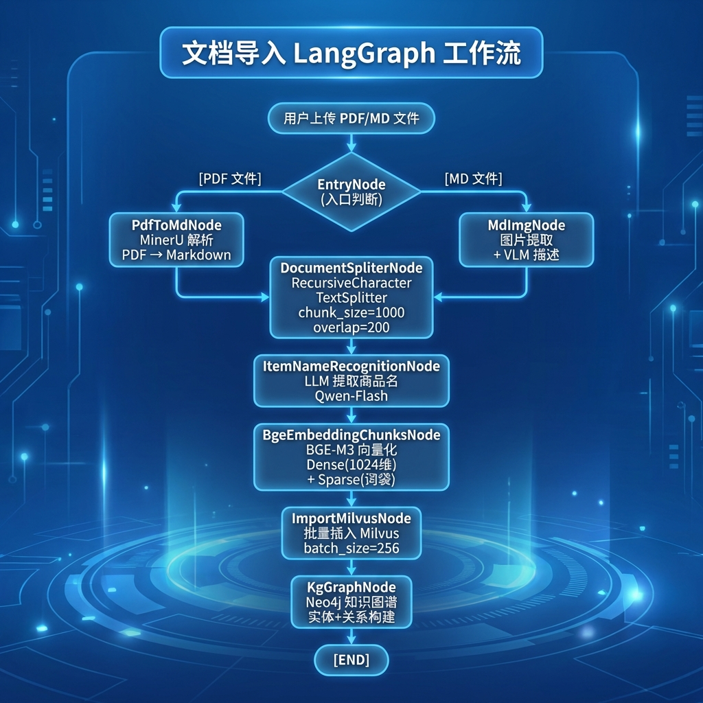
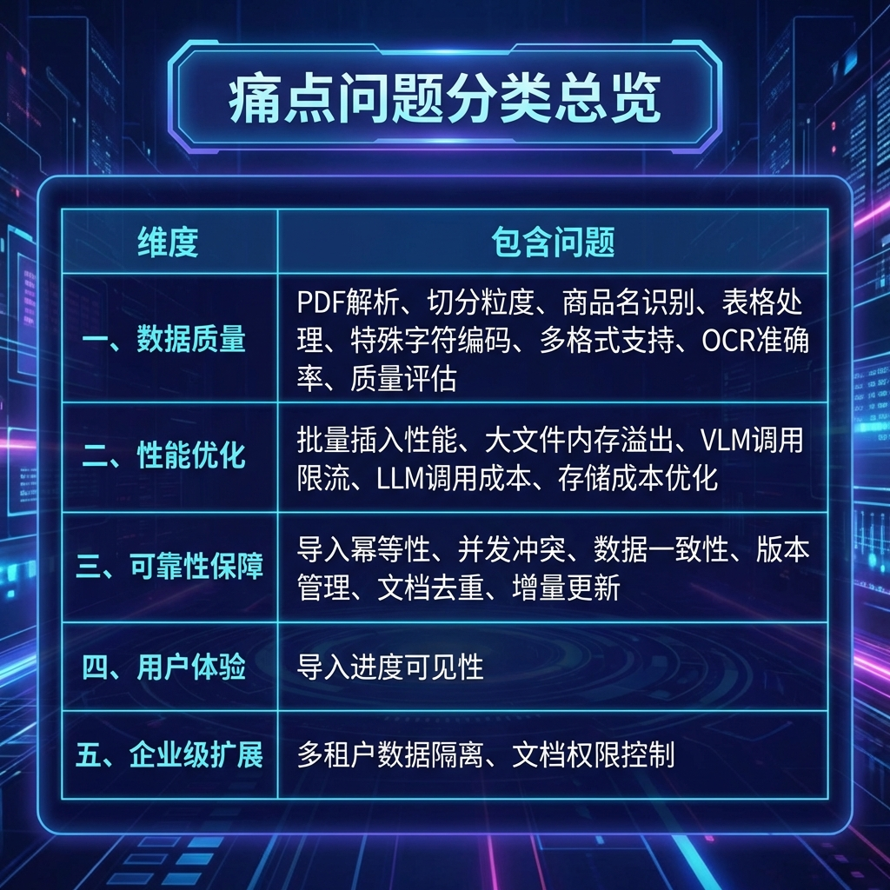

# 掌柜智库（导入篇）- 面试复习指南

> 本文档专注于**文档导入流程**的面试准备，涵盖PDF解析、图片处理、文档切分、向量化存储等核心模块。
>
> **文档目的**：帮助学生在面试前系统复习导入流程，掌握核心技术点和常见面试问题

---

## 目录

1. [目录概述](#1-项目概述)
2. [导入流程架构设计](#2-导入流程架构设计)
3. [核心模块实现](#3-核心模块实现)
   - 3.1 [入口节点 (EntryNode)](#31-入口节点-entrynode)
   - 3.2 [PDF转Markdown节点 (PdfToMdNode)](#32-pdf转markdown节点-pdftomdnode)
   - 3.3 [Markdown图片处理节点 (MarkDownToImgNode)](#33-markdown图片处理节点-markdowntoimgnode)
   - 3.4 [文档切分节点 (DocumentSplitNode)](#34-文档切分节点-documentsplitnode)
   - 3.5 [商品名识别节点 (ItemNameRecognitionNode)](#35-商品名识别节点-itemnamerecognitionnode)
   - 3.6 [向量化节点 (EmbeddingChunksNode)](#36-向量化节点-embeddingchunksnode)
   - 3.7 [Milvus导入节点 (ImportMilvusNode)](#37-milvus导入节点-importmilvusnode)
4. [技术细节与痛点分析](#4-技术细节与痛点分析)
5. [业务更换指南](#5-业务更换指南)
6. [面试高频问题与回答](#6-面试高频问题与回答)

---

## 1. 项目概述

### 1.1 项目背景

**项目名称**：智能知识库系统 - 文档导入模块

**业务场景**：为企业客户提供智能化的文档管理和知识提取服务，支持PDF/Markdown文档的自动解析、多模态内容提取、文档分割、向量化存储等功能。

**核心价值**：
- **PDF智能解析**：支持复杂格式PDF文档的准确解析
- **图片语义提取**：使用VLM为图片生成语义描述
- **智能文档切分**：标题层级切分 + 递归切分 + 贪心合并
- **商品名智能识别**：LLM提取 + 向量对齐存储
- **混合向量化**：BGE-M3 稠密向量 + 稀疏向量

### 1.2 技术选型

| 类别 | 技术栈 | 选型理由 |
|------|--------|----------|
| **AI框架** | LangGraph | 工作流编排，状态管理清晰 |
| **PDF解析** | MinerU | 开源工具，支持复杂格式，输出MD |
| **视觉模型** | Qwen3-VL-Flash | 国产VLM，中文图片理解强 |
| **大语言模型** | 通义千问 Qwen-Flash | 商品名提取，中文能力强 |
| **向量模型** | BGE-M3 (1024维) | 混合稠密+稀疏向量，兼顾语义和精确匹配 |
| **向量数据库** | Milvus | 支持混合检索，高性能 |
| **对象存储** | MinIO | 存储原始文档和图片 |

### 1.3 导入流程亮点

```
✅ MinerU PDF解析 - 子进程调用，支持复杂格式文档
✅ VLM图片描述提取 - Qwen3-VL生成图片语义摘要
✅ 智能文档切分 - 标题层级切分 + 递归切分 + 贪心合并
✅ 商品名智能识别 - LLM提取 + 向量对齐 + 降级回退
✅ BGE-M3混合向量 - 稠密向量语义理解 + 稀疏向量精确匹配
✅ 批量向量化 - batch_size=8，提升处理效率
✅ 门面+建造者模式 - Milvus Schema/Index/Insert分离
```

---

## 2. 导入流程架构设计

### 2.1 LangGraph 工作流图



### 2.2 导入开发周期

（Week 2-4）

| 任务            | 技术要点                                 | 负责角色 |
| --------------- | ---------------------------------------- | -------- |
| 基础设施搭建    | FastAPI 框架、日志系统、配置管理         | 后端开发 |
| 文件上传模块    | MinIO 集成、本地存储、任务状态管理       | 后端开发 |
| PDF 解析模块    | MinerU 集成、PDF 转 Markdown             | 后端开发 |
| 图片处理模块    | Qwen3-VL-Flash 图片描述生成              | 后端开发 |
| 文档分割模块    | LangChain RecursiveCharacterTextSplitter | 后端开发 |
| 商品名识别模块  | LLM 提示词工程、JSON 解析                | 后端开发 |
| 向量化模块      | BGE-M3 混合向量生成                      | 后端开发 |
| Milvus 导入模块 | 批量插入、集合管理                       | 后端开发 |
| 知识图谱构建    | Neo4j Cypher 查询、实体关系提取          | 后端开发 |


---

## 3. 核心模块实现

### 3.1 PDF转Markdown节点 

**核心职责**：

1. 使用MinerU工具将PDF转换为Markdown
2. 通过子进程调用，避免阻塞主流程
3. 实时输出解析日志
4. 返回转换后的MD文件路径

**节点实现**：

```python
# processor/import_process/nodes/pdf_to_md_node.py

class PdfToMdNode(BaseNode):
    """PDF转Markdown节点

    核心职责：
    1. 使用MinerU工具将PDF转换为Markdown
    2. 子进程调用，避免阻塞主流程
    3. 实时输出解析日志
    """

    name = "pdf_to_md_node"

    def process(self, state: ImportGraphState) -> ImportGraphState:
        # 1. 参数校验
        file_path = state.get('file_path')
        file_dir = state.get('file_dir')

        if not state.get('is_pdf'):
            self.logger.info("非PDF文件，跳过转换")
            return state

        # 2. 执行MinerU解析
        self._execute_mineru(file_path, file_dir)

        # 3. 获取生成的MD路径
        # MinerU输出格式: <output_dir>/<pdf_file_name>/hybrid_auto/<pdf_file_name>.md
        file_title = state.get('file_title')
        md_path = str(Path(file_dir) / file_title / "hybrid_auto" / f"{file_title}.md")

        if not Path(md_path).exists():
            raise PdfConversionError(f"MD文件未生成: {md_path}")

        # 4. 更新状态
        state['md_path'] = md_path
        self.logger.info(f"PDF转换完成: {md_path}")

        return state

    def _execute_mineru(self, import_file_path: str, file_dir_path: str):
        """执行MinerU子进程解析PDF"""
        cmd = [
            "mineru",
            "-p", str(import_file_path),
            "-o", str(file_dir_path),
            "--source", "local"
        ]

        # 创建子进程执行
        proc = subprocess.Popen(
            args=cmd,
            stdout=subprocess.PIPE,
            stderr=subprocess.STDOUT,
            errors="replace",
            text=True,
            encoding="utf-8",
            bufsize=1
        )

        # 实时输出日志
        for line in proc.stdout:
            self.logger.info(f"MinerU: {line.strip()}")

        # 等待进程结束
        return_code = proc.wait()

        if return_code != 0:
            raise PdfConversionError(f"MinerU解析失败，返回码: {return_code}")
```

**MinerU命令格式**：
```bash
mineru -p <input_pdf_path> -o <output_dir> --source local
```

**技术要点**：
- **子进程隔离**：MinerU在独立进程中运行，避免阻塞主进程
- **实时日志**：逐行读取输出，便于调试和监控
- **错误处理**：根据返回码判断是否成功

### 3.2 Markdown图片处理节点

**核心职责**：
1. 扫描MD文件中的图片引用
2. 提取每张图片的上下文（标题、上文、下文）
3. 使用VLM生成图片描述摘要
4. 上传图片到MinIO对象存储
5. 替换MD中的本地路径为远程URL

**节点实现**：

```python
# processor/import_process/nodes/md_to_img_node.py

class MarkDownToImgNode(BaseNode):
    """Markdown图片处理节点

    核心职责：
    1. 扫描MD文件中的图片引用
    2. 提取图片上下文
    3. VLM生成图片描述
    4. 上传MinIO并替换MD
    """

    name = "md_to_img_node"

    def process(self, state: ImportGraphState) -> ImportGraphState:
        # 1. 获取MD内容和路径
        md_path = state.get('md_path')
        file_title = state.get('file_title')

        if not md_path or not Path(md_path).exists():
            self.logger.warning("MD文件不存在，跳过图片处理")
            return state

        # 2. 读取MD内容
        with open(md_path, 'r', encoding='utf-8') as f:
            md_content = f.read()

        # 3. 扫描图片
        image_dir = Path(md_path).parent / "images"
        if not image_dir.exists():
            self.logger.info("没有图片目录，跳过图片处理")
            state['md_content'] = md_content
            state['has_images'] = False
            return state

        # 4. 扫描图片并提取上下文
        target_images_context = self._scan_images_and_context(
            image_dir, md_content, self.config
        )

        if not target_images_context:
            self.logger.info("未找到图片引用")
            state['md_content'] = md_content
            state['has_images'] = False
            return state

        # 5. VLM生成图片摘要
        images_summaries = self._extract_img_summary(
            file_title, target_images_context, self.config
        )

        # 6. 上传MinIO并替换MD
        new_md_content = self._upload_img_and_update_new_md(
            file_title, md_content, images_summaries, target_images_context, self.config
        )

        # 7. 更新状态
        state['md_content'] = new_md_content
        state['has_images'] = True

        self.logger.info(f"图片处理完成，共处理 {len(images_summaries)} 张图片")

        return state
```

**图片上下文提取算法**：

```python
def _find_img_context_with_limit(self, md_content: str, img_name: str, max_chars=200):
    """从MD文档中提取图片上下文信息"""
    # 1. 构建正则匹配图片引用
    re_pattern = re.compile(r"!\[.*?\]\(.*?" + re.escape(img_name) + r".*?\)")

    # 2. 按行分割MD内容
    md_lines = md_content.split("\n")
    imgs_context = []

    for line_idx, line in enumerate(md_lines):
        if not re_pattern.search(line):
            continue

        # 3. 向上查找最近的标题
        head_title = ""
        head_index = -1
        for i in range(line_idx - 1, -1, -1):
            if re.match(r"^#{1,6}\s+", md_lines[i]):
                head_title = md_lines[i]
                head_index = i
                break

        # 4. 提取上文（自下而上，按段落）
        pre_content = md_lines[head_index + 1:line_idx]
        img_pre_context = self._extract_img_context_with_limit(
            pre_content, max_chars, direction="front"
        )

        # 5. 提取下文
        post_content = md_lines[line_idx + 1:]
        img_post_context = self._extract_img_context_with_limit(
            post_content, max_chars, direction="end"
        )

        imgs_context.append((head_title, img_pre_context, img_post_context))

    return imgs_context
```

**VLM图片描述生成**：

```python
def _get_img_summary(self, config, client, document_title: str,
                     img_path: str, images_context: tuple) -> str:
    """使用VLM生成图片摘要"""

    # 1. 构建上下文
    section_title, pre_context, post_context = images_context
    context_parts = [section_title, pre_context, post_context]
    final_context = "\n".join([p for p in context_parts if p])

    # 2. 读取图片（base64编码）
    with open(img_path, "rb") as f:
        local_img_content = base64.b64encode(f.read()).decode("utf-8")

    # 3. 调用VLM（Qwen3-VL-Flash）
    response = client.chat.completions.create(
        model=config.vl_model,
        messages=[{
            "role": "user",
            "content": [
                {
                    "type": "text",
                    "text": f"""任务：为Markdown文档中的图片生成一个简短的中文标题。

背景信息：
1. 所属文档标题："{document_title}"
2. 图片上下文：
{final_context}

请结合图片视觉内容和上述上下文信息，用中文简要总结这张图片的内容，
生成一个精准的中文标题（不要包含"图片"二字）。"""
                },
                {
                    "type": "image_url",
                    "image_url": {
                        "url": f"data:image/jpeg;base64,{local_img_content}"
                    }
                }
            ]
        }]
    )

    return response.choices[0].message.content.strip()
```

### 3.3 文档切分节点

**核心职责**：
1. 根据Markdown标题层级切分文档
2. 对过长章节进行递归切分
3. 对过短章节进行贪心合并
4. 添加元数据（title, parent_title, file_title, part）

**节点实现**：

```python
# processor/import_process/nodes/document_split_node.py

class DocumentSplitNode(BaseNode):
    """文档切分节点

    核心职责：
    1. 根据Markdown标题层级切分文档
    2. 对过长章节进行递归切分
    3. 对过短章节进行贪心合并
    4. 添加元数据
    """

    name = "document_split_node"

    def process(self, state: ImportGraphState) -> ImportGraphState:
        # 1. 获取参数
        md_content = state.get('md_content')
        file_title = state.get('file_title')
        max_length = self.config.max_content_length      # 1000
        min_length = self.config.min_content_length      # 500

        # 2. 根据标题切分
        sections = self._split_by_headings(md_content, file_title)

        # 3. 处理（切分和合并）
        final_sections = self.split_and_merge(sections, max_length, min_length)

        # 4. 组装最终chunks
        chunks = self._assemble_chunk(final_sections)

        # 5. 更新状态
        state['chunks'] = chunks
        state['total_chunks'] = len(chunks)

        self.logger.info(f"文档切分完成，共生成 {len(chunks)} 个chunks")

        return state
```

**标题切分算法**：

```python
def _split_by_headings(self, md_content: str, file_title: str) -> list:
    """根据MD的标题（1-6级）进行切分"""
    in_fence = False
    body_lines = []
    sections = []
    current_level = 0
    current_title = ""
    hierarchy = [""] * 7  # hierarchy[1-6]存储各级标题

    heading_re = re.compile(r"^\s*(#{1,6})\s+(.+)")
    content_lines = md_content.split("\n")

    for content_line in content_lines:
        # 检查代码块围栏
        if content_line.strip().startswith("```") or content_line.strip().startswith("~~~"):
            in_fence = not in_fence

        match = heading_re.match(content_line) if not in_fence else None

        if match:
            # 保存上一个section
            if current_title or body_lines:
                parent_title = self._find_parent_title(hierarchy, current_level)
                sections.append({
                    "title": current_title if current_title else file_title,
                    "body": "\n".join(body_lines),
                    "file_title": file_title,
                    "parent_title": parent_title or current_title or file_title
                })

            # 更新当前标题
            level = len(match.group(1))
            current_level = level
            current_title = content_line
            hierarchy[level] = current_title

            # 清空下级标题
            for i in range(level + 1, 7):
                hierarchy[i] = ""

            body_lines = []
        else:
            body_lines.append(content_line)

    # 保存最后一个section
    if current_title or body_lines:
        sections.append({
            "title": current_title if current_title else file_title,
            "body": "\n".join(body_lines),
            "file_title": file_title,
            "parent_title": self._find_parent_title(hierarchy, current_level) or file_title
        })

    return sections
```

**递归切分与合并算法**：

```python
def split_and_merge(self, sections, max_content_length, min_content_length):
    """切分过长章节，合并过短章节"""

    # 1. 切分过长章节
    current_sections = []
    for section in sections:
        current_sections.extend(self.split_long_section(section, max_content_length))

    # 2. 合并过短章节（贪心累加算法）
    final_sections = self.merge_short_section(current_sections, min_content_length)

    return final_sections

def split_long_section(self, section, max_content_length):
    """使用RecursiveCharacterTextSplitter切分长内容"""
    title = section.get('title')
    body = section.get('body')

    total_length = len(title) + len(body)
    if total_length <= max_content_length:
        return [section]

    # 使用LangChain的递归切分器
    text_splitter = RecursiveCharacterTextSplitter(
        chunk_size=max_content_length,
        chunk_overlap=0,
        separators=["\n\n", "\n", "。", "！", "？", "；", ".", "!", "?", ";", " ", ""],
        keep_separator=False
    )

    texts = text_splitter.split_text(body)

    sub_sections = []
    for index, text in enumerate(texts):
        sub_sections.append({
            "title": f"{title}-{index + 1}",
            "body": text,
            "file_title": section.get('file_title'),
            "parent_title": section.get('parent_title'),
            "part": f"{index + 1}"
        })

    return sub_sections

def merge_short_section(self, current_sections, min_content_length):
    """贪心累加算法合并短章节"""
    if not current_sections:
        return []

    current_section = current_sections[0]
    final_sections = []

    for next_section in current_sections[1:]:
        same_parent = (current_section['parent_title'] == next_section['parent_title'])

        if same_parent and len(current_section.get('body')) < min_content_length:
            # 合并body
            current_section['body'] = (
                current_section.get('body').rstrip() + "\n\n" + next_section.get('body').lstrip()
            )
            current_section['title'] = current_section['parent_title']
            current_section['part'] = 0
        else:
            final_sections.append(current_section)
            current_section = next_section

    final_sections.append(current_section)

    # 重新编号part
    return self._renumber_parts(final_sections)
```

### 3.4 商品名识别节点 

**核心职责**：
1. 从文档前K个chunk中提取上下文
2. 使用LLM识别商品名称
3. 将商品名向量化（BGE-M3）
4. 存储到Milvus商品名集合
5. 回填item_name到所有chunks

**节点实现**：

```python
# processor/import_process/nodes/item_name_recognition_node.py

class ItemNameRecognitionNode(BaseNode):
    """商品名识别节点

    核心职责：
    1. 从文档前K个chunk中提取上下文
    2. LLM识别商品名
    3. 向量化存储到Milvus
    4. 回填到所有chunks
    """

    name = "item_name_recognition_node"

    def process(self, state: ImportGraphState) -> ImportGraphState:
        # 1. 参数校验
        file_title = state.get('file_title')
        chunks = state.get('chunks', [])

        if not chunks:
            self.logger.warning("没有chunks，跳过商品名识别")
            return state

        # 2. 构建LLM上下文（从前K个chunk中提取）
        item_name_context = self._prepare_item_name_context(chunks, self.config)

        # 3. LLM识别商品名
        item_name = self._recognition_item_name_by_llm(file_title, item_name_context)

        self.logger.info(f"识别到商品名: {item_name}")

        # 4. 向量化商品名
        dense_vector, sparse_vector = self._embedding_item_name(item_name)

        # 5. 存储到Milvus
        self._save_to_milvus(file_title, item_name, dense_vector, sparse_vector, self.config)

        # 6. 回填到所有chunks
        for chunk in chunks:
            chunk['item_name'] = item_name

        # 7. 更新状态
        state['item_name'] = item_name

        return state
```

**LLM商品名识别**：

```python
def _prepare_item_name_context(self, chunks, config):
    """从前K个chunk中构建上下文"""
    result = []
    total = 0

    for index, chunk in enumerate(chunks[:config.item_name_chunk_k]):  # 默认3个
        content = chunk.get('content')
        spices = f"【切片】- {index + 1} - {content}"
        result.append(spices)

        total += len(spices)
        if total > config.item_name_chunk_size:  # 默认2500
            break

    return "\n\n".join(result)[:config.item_name_chunk_size]

def _recognition_item_name_by_llm(self, file_title: str, item_name_context: str) -> str:
    """使用LLM识别商品名"""
    llm_client = get_llm_client()
    if llm_client is None:
        return file_title  # 降级回退

    prompt = ITEM_NAME_USER_PROMPT_TEMPLATE.format(
        file_title=file_title,
        context=item_name_context
    )

    try:
        llm_response = llm_client.invoke([
            SystemMessage(content=ITEM_NAME_SYSTEM_PROMPT),
            HumanMessage(content=prompt)
        ])

        item_name = llm_response.content.strip()
        if not item_name or item_name.upper() == 'UNKNOWN':
            return file_title  # 降级回退

        return item_name
    except Exception as e:
        self.logger.error(f"LLM调用失败，回退到文件标题: {e}")
        return file_title
```

**商品名向量化和存储**：

```python
def _embedding_item_name(self, item_name: str) -> tuple:
    """使用BGE-M3嵌入商品名"""
    embedding_model = get_beg_m3_embedding_model()
    embedding_result = embedding_model.encode_documents([item_name])

    # 获取稠密向量
    dense = embedding_result['dense'][0].tolist()

    # 获取稀疏向量
    start_index = embedding_result['sparse'].indptr[0]
    end_index = embedding_result['sparse'].indptr[1]
    weights = embedding_result['sparse'].data[start_index:end_index].tolist()
    tokenIds = embedding_result['sparse'].indices[start_index:end_index].tolist()
    sparse = dict(zip(tokenIds, weights))

    return dense, sparse

def _save_to_milvus(self, file_title, item_name, dense_vector, sparse_vector, config):
    """保存商品名到Milvus"""
    milvus_client = get_milvus_client()
    collection_name = config.item_name_collection

    # 幂等性校验
    if not milvus_client.has_collection(collection_name=collection_name):
        self._create_item_name_collection(milvus_client, collection_name)

    data = [{
        "file_title": file_title,
        "item_name": item_name,
        "dense_vector": dense_vector,
        "sparse_vector": sparse_vector
    }]

    result = milvus_client.insert(collection_name=collection_name, data=data)
    self.logger.info(f"已保存商品名到Milvus，ID: {result['ids'][0]}")
```

---

## 4. 技术细节与痛点分析

### 4.1 核心技术点

#### 4.1.1 BGE-M3 混合向量

**技术要点**：
- **稠密向量**：1024 维浮点向量，语义编码，L2 归一化
- **稀疏向量**：词袋 + 权重，BM25 风格，精确匹配
- **混合检索**：Milvus WeightedRanker 融合两路结果
- **权重配置**：稠密 50% + 稀疏 50%

#### 4.1.2 文档智能切分策略

**三级切分**：

1. **标题切分**：按 Markdown 标题层级（#-######）切分
2. **递归切分**：使用 LangChain 的 RecursiveCharacterTextSplitter
3. **贪心合并**：合并同父标题下的短章节

#### 4.1.3 VLM 图片描述生成

**技术要点**：

- **上下文提取**：提取图片的标题、上文、下文
- **Base64 编码**：图片转为 Base64 后传给 VLM
- **描述生成**：使用 Qwen3-VL-Flash 生成图片语义描述

#### 4.1.4 Milvus

1. 索引的选择---[向量字段的索引选择 标量字段的索引选择]
2. 检索的方式----【1.向量字段检索 2. 标量字段检索 3. 过滤：过滤方式】
3. API:不用聊

### 4.2 痛点问题与解决方案：面试主要聊的

> 以下痛点按五个维度分类：数据质量、性能优化、可靠性保障、用户体验、企业级扩展。
> 每个维度下的问题从"当前项目已解决"到"扩展设计思路"排列。



---

#### 一、数据质量类

> 这类问题关注"输入数据经过处理后的质量"，直接影响下游检索和回答的准确性。


##### 4.2.1 PDF 解析失败问题

**问题描述**：
用户上传的 PDF 文件格式多样，包含复杂表格、公式、图片等，直接解析可能导致内容丢失。

**解决方案**：
- 使用 MinerU 专业 PDF 解析工具
- 子进程调用，避免阻塞主进程
- 实时日志输出，便于监控
- 降级处理：解析失败时通知用户并提供替代方案

##### 4.2.2 文档切分粒度问题

**问题描述**：
文档切分时，chunk 过大会导致检索精度下降，chunk 过小会丢失上下文。

**解决方案**：

- **标题切分**：保持语义完整性
- **递归切分**：处理超长章节
- **贪心合并**：合并同父标题下的短章节

##### 4.2.3 商品名识别不准确问题

**问题描述**：
LLM 提取商品名时可能出现误判。

**解决方案**：

- **限制上下文**：从前 K 个 chunk 中提取，控制长度
- **降级回退**：识别失败时使用文件标题

##### 4.2.4 表格数据处理问题

**问题描述**：
PDF中的表格解析后格式混乱，Markdown表格不便于向量检索，Excel表结构复杂难以提取有效信息。

**解决方案**：
- **表格隔离保护法**：将表格视为 "不可侵犯的原子实体"
- **表头续传切分法 **：表格可以切，但必须保证每一块“残骸”都拥有完整的身份证。
- **降维转译法 **：消灭二维表格，将表格拍平，转译为高信息密度的自然语言。
- **VLM 视觉语言模型降维引擎**：弃代码解析，把排版解析工作外包给拥有“视觉”的AI模型、

##### 4.2.5 特殊字符和编码问题

**问题描述**：
文档中包含特殊字符、表情符号、全半角混用、编码不一致等问题，可能导致处理异常或检索效果下降。

**核心难点**

同一个内容在 Unicode 中可能有多种表示方式。如果不做规范化，PDF 里解析出来的文本和用户输入的文本"看起来一样但编码不同"，嵌入模型会把它们当成不同的文本，导致向量检索匹配不上。

```python
典型问题场景：

PDF 里解析出的商品名：  "ＲＳ－１２ 数字万用表"  （全角字符）
用户输入的查询：         "RS-12 数字万用表"       （半角字符）

不做规范化 → 嵌入模型认为是两段不同文本 → 向量检索匹配不上
做了 NFKC  → 两者都变成 "RS-12 数字万用表"  → 检索正常命中
```

**解决方案**：

- **Unicode规范化**：使用NFKC规范化统一字符编码
- **控制字符过滤**：移除不可见的控制字符
- **全半角转换**：统一全角和半角字符
- **引号标准化**：统一各种引号风格

**关于 NFKC：**

NFKC（Normalization Form Compatibility Composition）是 Unicode 四种规范化形式中最适合做检索预处理的一种。它会把语义等价但编码不同的字符统一成标准形式：

```python
NFKC 规范化效果：
全角字符 → 半角字符
  "Ｈｅｌｌｏ"  →  "Hello"
  "１２３"      →  "123"
  "ＲＳ－１２"  →  "RS-12"

特殊符号 → 标准字符
  "①②③"       →  "123"
  "㎝"          →  "cm"
  "㎡"          →  "m2"
```

**代码实现**：
```python
import unicodedata


def _sanitize_text(self, text: str) -> str:
    """
    清洗文本中的特殊字符。

    处理顺序：
    1. NFKC 规范化：统一全角/半角、特殊符号等兼容字符
    2. 控制字符过滤：移除不可见字符（保留换行和制表符）
    3. 引号标准化：统一中英文引号风格

    Args:
        text: 原始文本（如 PDF 解析出的文本）

    Returns:
        清洗后的文本
    """

    # 1. NFKC 规范化
    #    将全角字符转为半角（Ｈｅｌｌｏ → Hello）
    #    将特殊符号转为标准字符（① → 1, ㎝ → cm）
    text = unicodedata.normalize('NFKC', text)

    # 2. 移除控制字符（保留换行符和制表符）
    #    这些字符不可见，但可能导致嵌入模型产生异常向量
    text = ''.join(
        char for char in text
        if unicodedata.category(char)[0] != 'C'
        or char in '\n\t'
    )

    # 3. 统一引号风格
    #    中文双引号 "" → 英文双引号 "
    #    中文单引号 '' → 英文单引号 '
    #    避免同一段文本因引号不同而产生不同的嵌入向量
    text = text.replace('\u201c', '"').replace('\u201d', '"')  # "" → "
    text = text.replace('\u2018', "'").replace('\u2019', "'")  # '' → '

    return text
```

##### 4.2.6 多格式文档支持问题

**问题描述**：
企业内部文档数据源种类繁多，包括 Word (.docx)、Excel (.xlsx)、PPT (.pptx)、TXT、HTML、扫描件图片等多种格式，当前系统仅支持 PDF 和 Markdown，无法满足企业实际需求。

**解决方案**：

- **统一解析框架**：设计抽象基类 `DocumentParser`，所有格式解析器继承该基类
- **工厂模式**：使用 `DocumentParserFactory` 根据文件扩展名自动选择解析器
- **格式转换**：将各种格式统一转换为 Markdown 格式，便于后续处理
- **OCR支持**：对扫描件图片使用 Tesseract/PaddleOCR 进行文字识别

**代码实现**：
```python
from abc import ABC, abstractmethod
from typing import Dict, Any
import docx  # python-docx
import openpyxl  # Excel
import pptx  # PowerPoint
from PIL import Image
import pytesseract
from bs4 import BeautifulSoup
import markdown

class DocumentParser(ABC):
    """文档解析器抽象基类"""

    @abstractmethod
    def can_parse(self, file_path: str) -> bool:
        """判断是否支持该文件格式"""
        pass

    @abstractmethod
    def parse(self, file_path: str) -> Dict[str, Any]:
        """解析文档，返回统一格式"""
        pass

class MarkdownParser(DocumentParser):
    """Markdown解析器"""

    def can_parse(self, file_path: str) -> bool:
        return file_path.lower().endswith('.md')

    def parse(self, file_path: str) -> Dict[str, Any]:
        with open(file_path, 'r', encoding='utf-8') as f:
            content = f.read()
        return {
            "title": self._extract_title(content),
            "content": content,
            "format": "markdown"
        }

class WordParser(DocumentParser):
    """Word文档解析器 (.docx)"""

    def can_parse(self, file_path: str) -> bool:
        return file_path.lower().endswith('.docx')

    def parse(self, file_path: str) -> Dict[str, Any]:
        doc = docx.Document(file_path)

        # 提取标题
        title = doc.paragraphs[0].text if doc.paragraphs else ""

        # 提取段落内容
        paragraphs = []
        for para in doc.paragraphs:
            if para.text.strip():
                paragraphs.append(para.text.strip())

        # 提取表格
        tables = []
        for table in doc.tables:
            table_data = []
            for row in table.rows:
                row_data = [cell.text.strip() for cell in row.cells]
                table_data.append(row_data)
            tables.append(table_data)

        return {
            "title": title,
            "content": "\n".join(paragraphs),
            "tables": tables,
            "format": "word"
        }

class ExcelParser(DocumentParser):
    """Excel文档解析器 (.xlsx)"""

    def can_parse(self, file_path: str) -> bool:
        return file_path.lower().endswith(('.xlsx', '.xls'))

    def parse(self, file_path: str) -> Dict[str, Any]:
        workbook = openpyxl.load_workbook(file_path)

        all_sheets = []
        for sheet_name in workbook.sheetnames:
            sheet = workbook[sheet_name]
            sheet_data = []

            for row in sheet.iter_rows(values_only=True):
                row_data = [str(cell) if cell is not None else "" for cell in row]
                if any(cell.strip() for cell in row_data):  # 跳过空行
                    sheet_data.append(row_data)

            all_sheets.append({
                "name": sheet_name,
                "data": sheet_data
            })

        # 转换为文本格式
        content_parts = []
        for sheet in all_sheets:
            content_parts.append(f"## 工作表: {sheet['name']}")
            for row in sheet['data']:
                content_parts.append(" | ".join(row))

        return {
            "title": all_sheets[0]['name'] if all_sheets else "",
            "content": "\n".join(content_parts),
            "sheets": all_sheets,
            "format": "excel"
        }

class PowerPointParser(DocumentParser):
    """PowerPoint文档解析器 (.pptx)"""

    def can_parse(self, file_path: str) -> bool:
        return file_path.lower().endswith('.pptx')

    def parse(self, file_path: str) -> Dict[str, Any]:
        prs = pptx.Presentation(file_path)

        slides_content = []
        for slide_num, slide in enumerate(prs.slides, 1):
            slide_text = []

            # 提取文本框内容
            for shape in slide.shapes:
                if hasattr(shape, "text") and shape.text.strip():
                    slide_text.append(shape.text.strip())

            if slide_text:
                slides_content.append({
                    "slide_number": slide_num,
                    "content": "\n".join(slide_text)
                })

        # 合并所有幻灯片内容
        full_content = "\n\n".join([
            f"【幻灯片{s['slide_number']}】\n{s['content']}"
            for s in slides_content
        ])

        return {
            "title": prs.core_properties.title or "演示文稿",
            "content": full_content,
            "slides": slides_content,
            "format": "powerpoint"
        }

class HTMLParser(DocumentParser):
    """HTML文档解析器"""

    def can_parse(self, file_path: str) -> bool:
        return file_path.lower().endswith(('.html', '.htm'))

    def parse(self, file_path: str) -> Dict[str, Any]:
        with open(file_path, 'r', encoding='utf-8') as f:
            html = f.read()

        soup = BeautifulSoup(html, 'html.parser')

        # 移除脚本和样式
        for script in soup(['script', 'style']):
            script.decompose()

        # 提取标题
        title = soup.find('title')
        title_text = title.get_text() if title else ""

        # 提取主要内容
        main_content = soup.find('main') or soup.find('article') or soup.body
        content = main_content.get_text(separator='\n', strip=True) if main_content else ""

        return {
            "title": title_text,
            "content": content,
            "format": "html"
        }

class OCRImageParser(DocumentParser):
    """扫描件/图片OCR解析器"""

    def can_parse(self, file_path: str) -> bool:
        return file_path.lower().endswith(('.png', '.jpg', '.jpeg', '.tiff', '.bmp'))

    def parse(self, file_path: str) -> Dict[str, Any]:
        # 使用 Tesseract OCR
        image = Image.open(file_path)

        # 执行OCR
        text = pytesseract.image_to_string(image, lang='chi_sim+eng')

        return {
            "title": f"扫描件_{os.path.basename(file_path)}",
            "content": text,
            "format": "ocr_image"
        }

class DocumentParserFactory:
    """文档解析器工厂"""

    def __init__(self):
        self.parsers = [
            MarkdownParser(),
            WordParser(),
            ExcelParser(),
            PowerPointParser(),
            HTMLParser(),
            OCRImageParser(),
            # PDFParser(),  # 现有的PDF解析器
        ]

    def get_parser(self, file_path: str) -> DocumentParser:
        """根据文件类型获取对应的解析器"""
        for parser in self.parsers:
            if parser.can_parse(file_path):
                return parser

        raise UnsupportedFormatError(f"不支持的文件格式: {file_path}")

    def parse_document(self, file_path: str) -> Dict[str, Any]:
        """解析文档并返回统一格式"""
        parser = self.get_parser(file_path)
        return parser.parse(file_path)

# 使用示例
def import_multi_format_document(file_path: str):
    """导入多格式文档的统一入口"""
    factory = DocumentParserFactory()

    try:
        # 1. 根据文件类型选择解析器
        parsed_doc = factory.parse_document(file_path)

        # 2. 转换为统一的Markdown格式（便于后续处理）
        md_content = convert_to_markdown(parsed_doc)

        # 3. 后续处理流程（切分、向量化等）
        return process_markdown_document(md_content)

    except UnsupportedFormatError as e:
        logger.error(f"文档格式不支持: {str(e)}")
        return {"error": str(e)}

def convert_to_markdown(parsed_doc: Dict[str, Any]) -> str:
    """将解析结果转换为统一的Markdown格式"""
    format_type = parsed_doc.get("format")

    if format_type == "word":
        # Word文档转Markdown
        md = f"# {parsed_doc['title']}\n\n{parsed_doc['content']}"
        # 处理表格
        for table in parsed_doc.get("tables", []):
            md += "\n\n" + table_to_markdown(table)

    elif format_type == "excel":
        md = f"# {parsed_doc['title']}\n\n{parsed_doc['content']}"

    elif format_type == "powerpoint":
        md = f"# {parsed_doc['title']}\n\n{parsed_doc['content']}"

    elif format_type == "html":
        md = f"# {parsed_doc['title']}\n\n{parsed_doc['content']}"

    elif format_type == "ocr_image":
        md = f"# {parsed_doc['title']}\n\n{parsed_doc['content']}"

    else:
        md = parsed_doc.get("content", "")

    return md
```

**支持的格式总结**：

##### 4.2.7 OCR识别准确率问题

**问题描述**：
扫描件、图片文档经过OCR识别后，可能存在识别错误、乱码、公式丢失等问题，影响后续处理效果。

**解决方案**：

- **多引擎对比**：使用多个OCR引擎识别，选择最佳结果
- **图像预处理**：对图片进行灰度化、去噪、二值化等预处理
- **公式特殊处理**：使用专门的公式识别工具（如Mathpix API）
- **后处理校验**：对识别结果进行语法和语义校验，修正明显错误

**代码实现**：
```python
# 1. 多OCR引擎对比
class MultiOCREngine:
    """多OCR引擎对比，提高准确率"""

    def __init__(self):
        self.engines = [
            TesseractEngine(lang='chi_sim+eng'),
            PaddleOCREngine(),  # 百度OCR，中文效果好
            # 云端OCR API（阿里云、腾讯云等）
        ]

    def recognize(self, image_path: str) -> str:
        """使用多个引擎识别，选择最佳结果"""
        results = []
        for engine in self.engines:
            try:
                text = engine.recognize(image_path)
                results.append(text)
            except Exception as e:
                logger.warning(f"OCR引擎 {engine.name} 失败: {e}")

        # 简单策略：选择最长的结果（通常包含更多信息）
        return max(results, key=len) if results else ""

# 2. 图像预处理
def preprocess_image(image_path: str) -> str:
    """图像预处理，提高OCR准确率"""
    import cv2
    import numpy as np

    # 读取图像
    img = cv2.imread(image_path)

    # 灰度化
    gray = cv2.cvtColor(img, cv2.COLOR_BGR2GRAY)

    # 去噪
    denoised = cv2.fastNlMeansDenoising(gray)

    # 二值化
    _, binary = cv2.threshold(denoised, 0, 255, cv2.THRESH_BINARY + cv2.THRESH_OTSU)

    # 保存处理后的图像
    processed_path = image_path.replace('.', '_processed.')
    cv2.imwrite(processed_path, binary)

    return processed_path

# 3. 公式特殊处理
def process_formulas(content: str) -> str:
    """处理数学公式"""
    # 使用专门的公式识别工具（如Mathpix API）
    # 或保留LaTeX格式
    import re

    # 识别可能的公式区域

##### 4.2.8 文档质量评估问题

**问题描述**：
上传的文档质量参差不齐，可能包含大量无意义内容、格式混乱、信息密度低等问题，影响检索效果和用户体验。

**解决方案**：
- **多维度评估**：从内容密度、格式质量、可读性、完整性等维度评估
- **自动评分**：计算综合得分，给出质量等级（优秀/良好/一般/较差）
- **导入建议**：根据质量得分给出建议（直接导入/人工审核/重新整理）
- **用户反馈**：收集用户对文档质量的反馈，持续优化评估模型

**代码实现**：
​```python
class DocumentQualityAssessor:
    """文档质量评估器"""

    def assess(self, content: str, file_path: str) -> Dict[str, Any]:
        """综合评估文档质量"""
        scores = {
            "content_density": self._assess_content_density(content),
            "format_quality": self._assess_format_quality(content),
            "readability": self._assess_readability(content),
            "completeness": self._assess_completeness(content)
        }

        # 计算综合得分
        overall_score = sum(scores.values()) / len(scores)

        return {
            "overall_score": overall_score,
            "detail_scores": scores,
            "recommendation": self._get_recommendation(overall_score)
        }

    def _assess_content_density(self, content: str) -> float:
        """评估内容密度（有效信息/总长度）"""
        # 移除空白字符
        clean_content = ' '.join(content.split())

        if len(clean_content) < 100:
            return 0.0  # 内容太少

        # 计算中文字符比例
        chinese_chars = len([c for c in clean_content if '\u4e00' <= c <= '\u9fff'])
        density = chinese_chars / len(clean_content)

        return min(density * 2, 1.0)  # 归一化到0-1

    def _assess_format_quality(self, content: str) -> float:
        """评估格式质量"""
        score = 0.5  # 基础分

        # 有标题结构
        if '#' in content or '第' in content:
            score += 0.2

        # 有列表
        if '-' in content or '*' in content or '•' in content:
            score += 0.1

        # 有表格
        if '|' in content:
            score += 0.1

        # 无明显格式问题
        if not content.count('\n\n\n') > 5:  # 过多空行
            score += 0.1

        return min(score, 1.0)

    def _assess_readability(self, content: str) -> float:
        """评估可读性"""
        # 检查是否包含大量乱码
        invalid_chars = len([c for c in content if ord(c) > 127 and not ('\u4e00' <= c <= '\u9fff')])
        ratio = invalid_chars / len(content) if content else 0

        return max(1.0 - ratio * 10, 0.0)

    def _assess_completeness(self, content: str) -> float:
        """评估完整性"""
        score = 0.5  # 基础分

        # 有开头结尾
        if content[:100].count('。') > 0:
            score += 0.2

        if content[-100:].count('。') > 0:
            score += 0.2

        # 长度适中
        length = len(content)
        if 500 <= length <= 50000:
            score += 0.1

        return min(score, 1.0)

    def _get_recommendation(self, score: float) -> str:
        """根据得分给出建议"""
        if score >= 0.8:
            return "质量优秀，建议直接导入"
        elif score >= 0.6:
            return "质量良好，可以导入"
        elif score >= 0.4:
            return "质量一般，建议人工审核后导入"
        else:
            return "质量较差，建议重新整理后再导入"

# 在导入流程中调用
def import_with_quality_check(file_path: str):
    content = read_file_content(file_path)

    assessor = DocumentQualityAssessor()
    assessment = assessor.assess(content, file_path)

    if assessment['overall_score'] < 0.4:
        return {
            "warning": "文档质量较低",
            "assessment": assessment,
            "require_confirm": True
        }

    # 继续导入流程...
```

---

#### 二、性能优化类

> 这类问题关注“导入过程的速度和资源消耗”，影响系统的吞吐量和运营成本。

##### 4.2.9 批量插入性能问题

**问题描述**：
大批量文档导入时，逐条插入 Milvus 效率低下。

**解决方案**：
- **批量向量化**：batch_size=8
- **批量插入**：一次性插入多个 chunks
- **模型单例**：BGE-M3 使用单例模式

##### 4.2.10 大文件内存溢出问题

**问题描述**：
处理超大文件（如几百页的PDF、大型Excel文档等）时，一次性加载全部内容到内存可能导致内存溢出，程序崩溃。

> 1.断点续传：缓存部分数据
>
> 2.分片上传---->合并（对小文件合并）【多线程并发】
>
> 3.秒传：缓存思想（缓存全量）

- **内存监控**：实时监控内存使用情况，超过阈值时触发GC
- **临时文件**：超大文件可写入临时文件，处理完成后删除

**代码实现**：
```python
# 流式读取大文件
def _read_large_file_in_chunks(self, file_path: str, chunk_size: int = 1024):
    """分块读取大文件，避免内存溢出"""
    with open(file_path, 'r', encoding='utf-8') as f:
        while True:
            chunk = f.read(chunk_size)
            if not chunk:
                break
            yield chunk

# 分批处理
for batch_start in range(0, total_chunks, batch_size):
    batch = all_chunks[batch_start:batch_start + batch_size]
    # 处理当前批次...
```

##### 4.2.11 图片VLM调用限流问题

**问题描述**：
大量图片需要调用VLM生成描述时，可能触发API速率限制，导致导入失败或请求被拒绝。

**解决方案**：
- **装饰器限流**：使用 `@limits` 装饰器限制调用频率
- **令牌桶算法**：平滑处理请求，避免突发流量
- **重试机制**：调用失败时自动重试，并逐步增加重试间隔
- **队列缓冲**：将图片请求放入队列，按速率逐步处理

**代码实现**：

```python
import time
from ratelimit import limits, sleep_and_retry

@sleep_and_retry
@limits(calls=15, period=60)  # 每分钟最多15次调用
def _call_vlm_with_rate_limit(self, image_data):
    """带限流的VLM调用"""
    # VLM调用逻辑...
    return result

# 令牌桶算法
class RateLimiter:
    def __init__(self, rate=15, per=60):
        self.rate = rate
        self.per = per
        self.allowance = rate
        self.last_check = time.time()

    def acquire(self):
        now = time.time()
        elapsed = now - self.last_check
        self.allowance += elapsed * (self.rate / self.per)
        if self.allowance > self.rate:
            self.allowance = self.rate
        if self.allowance < 1:
            # 等待足够的时间
            sleep_time = (self.per - self.rate) / self.rate
            time.sleep(sleep_time)
            self.allowance += 1
        self.allowance -= 1
        self.last_check = now
```

##### 4.2.12 LLM调用成本优化问题

**问题描述**：
大量文档调用LLM提取商品名、生成图片描述，API调用次数多、成本较高，需要优化降低费用。

**解决方案**：
- **结果缓存**：缓存已识别的商品名和图片描述，避免重复调用
- **批量处理**：将多个请求合并为一次批量调用
- **智能跳过**：对于简单场景使用规则提取，减少LLM调用
- **模型降级**：非关键场景使用更便宜的模型

**代码实现**：

```python
# 缓存已识别的商品名
_item_name_cache = {}

def _get_or_extract_item_name(self, file_title: str, context: str):
    """优先使用缓存，避免重复调用LLM"""
    # 生成缓存key
    cache_key = hashlib.md5(f"{file_title}{context[:200]}".encode()).hexdigest()

    if cache_key in _item_name_cache:
        self.logger.info(f"使用缓存商品名: {_item_name_cache[cache_key]}")
        return _item_name_cache[cache_key]

    # 调用LLM提取
    item_name = self._recognition_item_name_by_llm(file_title, context)

    # 存入缓存
    _item_name_cache[cache_key] = item_name
    return item_name

# 图片描述批量处理
def _batch_extract_image_descriptions(self, images: list):
    """批量提取图片描述，减少API调用次数"""
    # 将多张图片合并为一个请求
    combined_prompt = "请为以下图片分别生成简短描述：\n"
    for i, img_info in enumerate(images):
        combined_prompt += f"\n图片{i+1}: {img_info['context'][:50]}..."

    # 单次调用获取多个结果
    response = llm_client.invoke([
        HumanMessage(content=combined_prompt)
    ])

    # 解析并分配结果
    return self._parse_batch_results(response.content)
```

##### 4.2.13 存储成本优化问题

**问题描述**：
大量文档和向量数据存储成本高，需要优化存储空间，降低运营成本。

**解决方案**：

- **向量压缩**：稀疏向量只保留高权重token，减少存储空间
- **定期清理**：通过 MongoDB 版本记录定位过期数据，清理 Milvus 中的残留
- **冷热分离**：将不常用的数据迁移到低成本存储
- **数据去重**：识别并删除重复的文档和chunk

**代码实现**：
```python
# 向量压缩
def _compress_sparse_vector(self, sparse_vector: dict) -> dict:
    """压缩稀疏向量，只保留高权重token"""
    # 按权重排序，只保留前50%
    sorted_items = sorted(sparse_vector.items(),
                        key=lambda x: x[1], reverse=True)
    keep_count = int(len(sorted_items) * 0.5)
    return dict(sorted_items[:keep_count])

# 定期清理过期数据（基于 MongoDB 版本记录）
def _cleanup_old_versions(self, mongo_collection, milvus_client):
    """清理非最新版本的残留数据"""
    # 从 MongoDB 找到所有非最新版本的文档
    old_versions = mongo_collection.find({"is_latest": False})

    for record in old_versions:
        file_title = record["file_title"]
        # 检查 Milvus 中是否有该文档的残留数据（正常情况下不会有）
        existing = milvus_client.query(
            collection_name=self.config.chunks_collection,
            filter=f"file_title == '{file_title}'",
            output_fields=["chunk_id"]
        )
        # 如果有残留，清理掉
        if existing.get("data"):
            ids = [e["chunk_id"] for e in existing["data"]]
            milvus_client.delete(collection_name=self.config.chunks_collection, ids=ids)
```

---

#### 三、可靠性保障类

> 这类问题关注“导入过程中出错时数据的安全性和可恢复性”。核心前提：Milvus 不支持事务也不支持 update，因此需要配合 MongoDB 来保障数据一致性。

##### 4.2.14 文档导入幂等性问题

**问题描述**

用户重复上传同一文档，或导入失败后重试，可能导致数据重复插入，造成存储浪费和检索结果重复。

**核心难点**

Milvus 不支持事务机制，无法将"删除旧数据"和"插入新数据"包装成一个原子操作。 如果采用"先删后插"，删除成功但插入失败时，数据就丢了。

**解决方案**

采用"先插后删"策略，通过版本号保证数据安全：

- **版本标记**：为每批数据添加 import_version（时间戳），区分新旧数据
- **导入前检查**：根据文件标题查询是否已存在旧版本数据
- **先插后删**：先插入新版本数据，确认成功后再删除旧版本数据
- **失败兜底**：如果插入失败，旧数据仍然完整可用，不影响线上查询

**代码实现**：
```python
import time

def idempotent_import(self, file_title: str, new_chunks: list, milvus_client):
    """
    幂等导入：先插新数据，成功后再删旧数据。
    即使 Milvus 没有事务，也能保证数据不丢失。
    """
    collection = self.config.chunks_collection

    # 1. 生成本次导入的版本号（时间戳）
    new_version = int(time.time())

    # 2. 查询是否已存在该文档的旧数据
    filter_expr = f"file_title == '{file_title}'"
    existing = milvus_client.query(
        collection_name=collection,
        filter=filter_expr,
        output_fields=["chunk_id", "import_version"]
    )
    old_ids = [e['chunk_id'] for e in existing.get('data', [])]

    # 3. 为新数据打上版本号，然后插入
    for chunk in new_chunks:
        chunk['import_version'] = new_version

    try:
        milvus_client.insert(
            collection_name=collection,
            data=new_chunks
        )
        self.logger.info(f"插入新数据: {len(new_chunks)} 条, version={new_version}")
    except Exception as e:
        # 插入失败，旧数据仍然完整，不影响线上查询
        self.logger.error(f"插入新数据失败: {e}，旧数据保持不变")
        return

   # 4. 插入成功后，删除旧版本数据
    if old_ids:
        max_retries = 3
        for attempt in range(1, max_retries + 1):
            try:
                milvus_client.delete(
                    collection_name=collection,
                    ids=old_ids
                )
                self.logger.info(f"删除旧数据: {len(old_ids)} 条")
                break
            except Exception as e:
                self.logger.warning(f"删除旧数据第 {attempt} 次失败: {e}")
                if attempt == max_retries:
                    # 重试耗尽，记录到待清理表，由定时任务后续处理 这样即使删除当场失败，数据共存的窗口也是有限的，不会一直影响检索。
                    self._record_pending_cleanup(file_title, old_ids)
                    self.logger.error(
                        f"删除旧数据重试耗尽，已记录到待清理队列，"
                        f"file_title={file_title}, 待删除 {len(old_ids)} 条"
                    )
```


##### 4.2.15 多文档并发导入问题

**问题描述**：
多个用户同时上传文档时，可能导致资源竞争、数据库连接耗尽、性能下降甚至服务崩溃。

**核心难点：**

文档导入是重操作（PDF 解析 → 分块 → 嵌入 → 写入 Milvus），如果不限制并发：

- 多个任务同时调用嵌入模型，内存/GPU 资源被打满
- 多个任务同时写 Milvus，连接数耗尽
- 同一文档被多人同时上传，可能产生重复数据

**解决方案**：

- **线程池**：使用 `ThreadPoolExecutor` 管理任务的异步执行，自动排队
- **信号量**：使用 `Semaphore` 控制同时执行的任务数上限
- **异常安全**：通过 `finally` 确保异常时也能释放资源，不会卡死

**代码实现**：
```python
import logging
import threading
from concurrent.futures import ThreadPoolExecutor, Future
from typing import Callable, Any

logger = logging.getLogger(__name__)


class ImportTaskQueue:

    def __init__(self, max_concurrent: int = 3):
        self._semaphore = threading.Semaphore(max_concurrent)
        self._executor = ThreadPoolExecutor(max_workers=max_concurrent)

        # 文件级锁：同一文档同一时间只允许一个任务处理
        self._file_locks = {}       # {file_title: Lock}
        self._file_locks_guard = threading.Lock()  # 保护 _file_locks 字典本身

    def _get_file_lock(self, file_title: str) -> threading.Lock:
        """获取指定文档的锁（没有就创建）"""
        with self._file_locks_guard:
            if file_title not in self._file_locks:
                self._file_locks[file_title] = threading.Lock()
            return self._file_locks[file_title]

    def submit_task(self, task_id: str, import_fn: Callable,
                    file_title: str, *args: Any) -> Future:
        """提交导入任务"""
        logger.info(f"任务 {task_id} 已提交，文档: {file_title}")
        future = self._executor.submit(
            self._run_task, task_id, import_fn, file_title, *args
        )
        return future

    def _run_task(self, task_id: str, import_fn: Callable,
                  file_title: str, *args: Any) -> None:
        """执行导入任务（信号量控制并发 + 文件锁防重复）"""

        # 1. 获取信号量（控制总并发数）
        self._semaphore.acquire()
        try:
            # 2. 获取文件锁（同一文档串行执行）
            file_lock = self._get_file_lock(file_title)
            with file_lock:
                logger.info(f"任务 {task_id} 开始执行，文档: {file_title}")
                import_fn(file_title, *args)
                logger.info(f"任务 {task_id} 执行成功")
        except Exception as e:
            logger.error(f"任务 {task_id} 执行失败: {e}")
            raise
        finally:
            # 3. 释放信号量
            self._semaphore.release()

    def shutdown(self, wait: bool = True) -> None:
        self._executor.shutdown(wait=wait)
        logger.info("任务队列已关闭")
```

##### 4.2.16 数据一致性保证问题

**问题描述**：
导入过程中某个环节失败（如向量化失败、数据库插入中断），如何保证数据的一致性，避免出现部分数据导入成功、部分失败的情况。

**核心思路：**

既然 Milvus 不支持事务也不支持 update，就不要在 Milvus 里模拟事务。正确的做法是：**用 MongoDB 管状态，Milvus 只在全部准备好之后才写入**。

**解决方案**：

```
导入流程（分阶段，每个阶段有明确的状态）：

  ① PDF 解析 → 得到原始文本
       │  失败 → 状态标记为 parse_failed，无需清理
       ▼
  ② 文本分块 → 得到 chunks 列表
       │  失败 → 状态标记为 chunk_failed，无需清理
       ▼
  ③ 向量化 → 每个 chunk 得到嵌入向量
       │  失败 → 状态标记为 embed_failed，无需清理
       │  （以上三步都没有写入 Milvus，失败了不会产生脏数据）
       ▼
  ④ 写入 Milvus → 一次性插入所有 chunks
       │  失败 → 状态标记为 insert_failed
       │         已插入的数据通过 transaction_id 清理
       ▼
  ⑤ 全部完成 → 状态标记为 success
```

**代码实现**：
```python
import uuid
import time
import logging
from typing import List, Dict, Any

logger = logging.getLogger(__name__)


class TransactionalImporter:
    """
    事务性文档导入器

    设计原则：
    - MongoDB 管状态：记录每次导入的状态（pending → success / failed）
    - Milvus 最后写入：所有准备工作完成后才写入 Milvus，减少脏数据
    - 失败可重试：通过 transaction_id 定位并清理残留数据
    """

    def __init__(self, milvus_client, mongo_collection):
        """
        Args:
            milvus_client:    Milvus 客户端
            mongo_collection: MongoDB 集合（记录导入任务的状态）
        """
        self._milvus = milvus_client
        self._mongo = mongo_collection

    def import_document(self, file_title: str, raw_text: str,
                        parse_fn, chunk_fn, embed_fn,
                        collection: str) -> str:
        """
        事务性导入文档

        流程：解析 → 分块 → 向量化 → 写入 Milvus
        前三步都不碰 Milvus，只有全部准备好后才一次性写入。

        Args:
            file_title:  文档标题
            raw_text:    原始文本
            parse_fn:    解析函数
            chunk_fn:    分块函数
            embed_fn:    向量化函数
            collection:  Milvus 集合名

        Returns:
            transaction_id: 本次导入的事务 ID
        """
        # 1. 生成事务 ID
        transaction_id = str(uuid.uuid4())

        # 2. 在 MongoDB 中创建导入任务记录（初始状态：pending）
        task_record = {
            "transaction_id": transaction_id,
            "file_title": file_title,
            "status": "pending",
            "start_time": time.strftime("%Y-%m-%dT%H:%M:%S"),
            "chunk_count": 0,
            "error": None
        }
        self._mongo.insert_one(task_record)

        try:
            # 3. 解析（不碰 Milvus）
            parsed_content = parse_fn(raw_text)

            # 4. 分块（不碰 Milvus）
            chunks = chunk_fn(parsed_content)

            # 5. 向量化（不碰 Milvus）
            embedded_chunks = embed_fn(chunks)

            # 6. 为每个 chunk 打上 transaction_id（用于失败时定位清理）
            for chunk in embedded_chunks:
                chunk["transaction_id"] = transaction_id
                chunk["file_title"] = file_title

            # 7. 一次性写入 Milvus（这是唯一碰 Milvus 的地方）
            self._milvus.insert(collection_name=collection, data=embedded_chunks)

            # 8. 写入成功，更新 MongoDB 状态
            self._mongo.update_one(
                {"transaction_id": transaction_id},
                {"$set": {
                    "status": "success",
                    "chunk_count": len(embedded_chunks),
                    "end_time": time.strftime("%Y-%m-%dT%H:%M:%S")
                }}
            )
            logger.info(f"导入成功: {file_title}, {len(embedded_chunks)} 条, "
                        f"transaction_id={transaction_id}")

        except Exception as e:
            # 9. 任何环节失败，记录错误状态
            error_msg = str(e)
            self._mongo.update_one(
                {"transaction_id": transaction_id},
                {"$set": {
                    "status": "failed",
                    "error": error_msg,
                    "end_time": time.strftime("%Y-%m-%dT%H:%M:%S")
                }}
            )
            logger.error(f"导入失败: {file_title}, transaction_id={transaction_id}, "
                         f"错误: {error_msg}")

            # 10. 尝试清理 Milvus 中可能残留的数据
            self._cleanup_milvus(transaction_id, collection)
            raise

        return transaction_id

    def _cleanup_milvus(self, transaction_id: str, collection: str) -> None:
        """
        清理 Milvus 中指定事务的残留数据

        插入可能部分成功（如批量插入中途失败），
        通过 transaction_id 过滤并删除这些残留数据。
        """
        try:
            # 查询该事务是否有残留数据
            existing = self._milvus.query(
                collection_name=collection,
                filter=f"transaction_id == '{transaction_id}'",
                output_fields=["chunk_id"]
            )
            residual_ids = [e["chunk_id"] for e in existing.get("data", [])]

            if residual_ids:
                self._milvus.delete(collection_name=collection, ids=residual_ids)
                logger.info(f"已清理残留数据: {len(residual_ids)} 条, "
                            f"transaction_id={transaction_id}")
        except Exception as cleanup_error:
            # 清理也失败了，记录到 MongoDB，由定时任务后续处理
            self._mongo.update_one(
                {"transaction_id": transaction_id},
                {"$set": {"cleanup_needed": True}}
            )
            logger.error(f"清理残留数据失败: {cleanup_error}, "
                         f"已标记 cleanup_needed，等待定时任务处理")


    def cleanup_stale_tasks(self, collection: str, timeout_seconds: int = 3600) -> None:
        """
        定时清理任务：处理标记了 cleanup_needed 的残留数据

        建议通过定时任务（如 cron）定期调用此方法。

        Args:
            collection:      Milvus 集合名
            timeout_seconds: 超过多久的 pending 任务视为异常（默认 1 小时）
        """
        # 1. 处理标记了 cleanup_needed 的任务
        stale_tasks = self._mongo.find({"cleanup_needed": True})
        for task in stale_tasks:
            tid = task["transaction_id"]
            self._cleanup_milvus(tid, collection)
            self._mongo.update_one(
                {"transaction_id": tid},
                {"$unset": {"cleanup_needed": ""}}
            )
            logger.info(f"定时清理完成: transaction_id={tid}")
```

##### 4.2.17 文档版本管理问题

**问题描述**：
同一文档多次更新后，如何管理不同版本的数据，确保检索时使用最新版本，同时保留历史版本供追溯和回滚。

**解决方案**：

将版本管理和向量检索分离：**MongoDB 管版本，Milvus 只存最新版本**。

1. 首次上传文档 (Create)

- **Step 1 [处理]**：系统接收文件->提取文本->大模型分块与向量化。
- **Step 2 [记账]**：存入 **MongoDB**。记录版本为 `v1`，标记 `is_latest = True`，并保存完整的文本分块快照。
- **Step 3 [上架]**：将生成的向量数据写入 **Milvus**。

2. 更新已有文档 (Update)

- **Step 1 [处理]**：接收修改后的文件-> 重新提取->重新向量化。
- **Step 2 [记账]**：存入 **MongoDB**。新增一条 `v2` 记录，标记 `is_latest = True`，保存新快照；**同时**将旧版 `v1` 的标记改为 `is_latest = False`。
- **Step 3 [下架]**：从 **Milvus** 中删除旧版 `v1` 的所有相关向量。
- **Step 4 [上架]**：将新版 `v2` 的向量数据写入 **Milvus**。

3.  用户知识检索 (Search)

- **Step 1 [提问]**：用户输入查询问题。
- **Step 2 [直达]**：系统**直接**拿着问题去 **Milvus** 中进行相似度搜索。

4. 历史版本回滚 (Rollback)

- **Step 1 [指令]**：管理员发现 v2 传错了，点击“退回 v1”。
- **Step 2 [改账]**：在 **MongoDB** 中，将 `v2` 的 `is_latest` 改为 `False`，将 `v1` 改回 `True`。
- **Step 3 [下架]**：从 **Milvus** 中删除报错的 `v2` 向量。
- **Step 4 [恢复]**：直接从 **MongoDB** 提取 `v1` 当时存好的快照（包含原有的向量数据），**直接写入 Milvus**。


**代码实现**：

```python
import time
import logging
from typing import List, Dict, Any

logger = logging.getLogger(__name__)


class VersionedImporter:
    """带版本管理的文档导入器"""

    def __init__(self, milvus_client, mongo_collection):
        """
        Args:
            milvus_client:    Milvus 客户端（只存最新版本，负责向量检索）
            mongo_collection: MongoDB 集合（存所有版本，负责版本管理）
        """
        self._milvus = milvus_client
        self._mongo = mongo_collection

    def import_document(self, file_title: str, chunks: List[Dict[str, Any]],
                        operator: str = "") -> None:
        """
        导入新版本文档

        流程：
        1. MongoDB：将旧版本标记为非最新
        2. MongoDB：保存新版本记录（含完整 chunks 快照）
        3. Milvus：先插入新数据，成功后删除旧数据（先插后删，不丢数据）

        Args:
            file_title: 文档标题
            chunks:     分块后的数据列表
            operator:   操作人
        """
        # 1. 生成版本号
        version = f"v_{int(time.time())}"

        # 2. MongoDB：将该文档的旧版本标记为非最新（原子操作）
        self._mongo.update_many(
            {"file_title": file_title, "is_latest": True},
            {"$set": {"is_latest": False}}
        )

        # 3. MongoDB：保存新版本记录（含完整 chunks 快照，用于回滚）
        version_record = {
            "file_title": file_title,
            "version": version,
            "import_time": time.strftime("%Y-%m-%dT%H:%M:%S"),
            "is_latest": True,
            "operator": operator,
            "chunk_count": len(chunks),
            "chunks_snapshot": chunks  # 完整快照，回滚时直接取出重新导入
        }
        self._mongo.insert_one(version_record)
        logger.info(f"MongoDB 版本记录已保存: {file_title} {version}")

        # 4. Milvus：查询旧数据的 ID
        collection = "kb_chunks_v1"
        existing = self._milvus.query(
            collection_name=collection,
            filter=f"file_title == '{file_title}'",
            output_fields=["chunk_id"]
        )
        old_ids = [e["chunk_id"] for e in existing.get("data", [])]

        # 5. Milvus：插入新数据
        try:
            self._milvus.insert(collection_name=collection, data=chunks)
            logger.info(f"Milvus 插入新数据: {len(chunks)} 条, {version}")
        except Exception as e:
            # 插入失败，旧数据还在，不影响检索
            # 但 MongoDB 中已经记录了新版本，需要回滚 MongoDB
            self._mongo.delete_one({"file_title": file_title, "version": version})
            self._mongo.update_many(
                {"file_title": file_title},
                {"$set": {"is_latest": True}}  # 恢复旧版本标记
            )
            logger.error(f"Milvus 插入失败，已回滚 MongoDB 版本记录: {e}")
            return

        # 6. Milvus：删除旧数据
        if old_ids:
            try:
                self._milvus.delete(collection_name=collection, ids=old_ids)
                logger.info(f"Milvus 删除旧数据: {len(old_ids)} 条")
            except Exception as e:
                logger.warning(f"Milvus 删除旧数据失败: {e}，新旧数据暂时共存")

    def rollback(self, file_title: str, target_version: str) -> None:
        """
        回滚到指定版本

        从 MongoDB 取出历史版本的 chunks，重新导入 Milvus。

        Args:
            file_title:      文档标题
            target_version:  要回滚到的版本号
        """
        # 1. 从 MongoDB 查找目标版本
        record = self._mongo.find_one({
            "file_title": file_title,
            "version": target_version
        })

        if not record:
            logger.error(f"未找到版本: {file_title} {target_version}")
            return

        # 2. 取出该版本的 chunks 快照
        chunks = record.get("chunks_snapshot", [])
        if not chunks:
            logger.error(f"版本 {target_version} 的 chunks 快照为空")
            return

        # 3. 用 import_document 重新导入（会自动处理 Milvus 先插后删 + MongoDB 版本记录）
        logger.info(f"开始回滚: {file_title} → {target_version}")
        self.import_document(file_title, chunks, operator="rollback")

    def get_history(self, file_title: str) -> list:
        """
        查询文档的所有版本历史

        Args:
            file_title: 文档标题

        Returns:
            版本记录列表（按时间倒序，不含 chunks_snapshot 以减少数据量）
        """
        cursor = self._mongo.find(
            {"file_title": file_title},
            {"chunks_snapshot": 0}  # 排除快照字段，减少返回数据量
        ).sort("import_time", -1)

        return list(cursor)
```

##### 4.2.18 文档去重问题

**问题描述**：
同一文档可能被多次上传，或相似文档重复导入，导致知识库中存在大量重复内容，影响检索效率和准确性。

**解决方案**：
- **文件哈希去重**：计算文件MD5哈希，精确判断是否为同一文件
- **内容相似度去重**：使用文本相似度算法识别高度相似的文档
- **向量检索去重**：通过向量检索发现语义相似的重复文档
- **用户确认机制**：发现疑似重复时，提示用户确认是否继续

**代码实现**：
```python
import hashlib
from difflib import SequenceMatcher

class DocumentDeduplicator:
    """文档去重器"""

    def __init__(self, milvus_client):
        self.milvus_client = milvus_client

    def check_duplicate_by_hash(self, file_path: str) -> bool:
        """基于文件哈希检查重复"""
        # 计算文件MD5
        md5_hash = self._calculate_file_hash(file_path)

        # 查询向量数据库
        filter_expr = f"file_hash == '{md5_hash}'"
        existing = self.milvus_client.query(
            collection_name="chunks_collection",
            filter=filter_expr,
            output_fields=["chunk_id"]
        )

        return len(existing.get('data', [])) > 0

    def check_duplicate_by_similarity(self, content: str, threshold=0.95) -> bool:
        """基于内容相似度检查重复"""
        # 生成向量
        embedding = generate_embedding(content)

        # 向量检索
        results = self.milvus_client.search(
            collection_name="chunks_collection",
            data=[embedding],
            limit=5,
            output_fields=["content", "file_title"]
        )

        # 计算相似度
        for hit in results[0]:
            similarity = self._text_similarity(content, hit['entity']['content'])
            if similarity >= threshold:
                logger.info(f"发现重复文档: {hit['entity']['file_title']}, 相似度: {similarity}")
                return True

        return False

    def _calculate_file_hash(self, file_path: str) -> str:
        """计算文件哈希值"""
        hash_md5 = hashlib.md5()
        with open(file_path, "rb") as f:
            for chunk in iter(lambda: f.read(4096), b""):
                hash_md5.update(chunk)
        return hash_md5.hexdigest()

    def _text_similarity(self, text1: str, text2: str) -> float:
        """计算文本相似度"""
        return SequenceMatcher(None, text1, text2).ratio()

# 在导入流程中调用
def import_with_deduplication(file_path: str):
    deduplicator = DocumentDeduplicator(milvus_client)

    # 检查文件哈希重复
    if deduplicator.check_duplicate_by_hash(file_path):
        return {"error": "文档已存在（文件哈希相同）"}

    # 检查内容相似度重复
    content = read_file_content(file_path)
    if deduplicator.check_duplicate_by_similarity(content):
        return {"warning": "存在相似文档，请确认是否继续导入"}

    # 继续导入流程...
```

##### 4.2.19 增量更新问题

**问题描述**：
文档更新后，如何高效地进行增量更新，只处理变化的部分，而不是全量重新导入，以节省时间和资源。

**解决方案**：
- **变化检测**：通过哈希对比检测文档和chunk的变化
- **增量删除**：只删除已变化的旧chunk，保留未变化的chunk
- **增量插入**：只插入新增或修改的chunk
- **版本标记**：使用版本号和更新时间戳追踪变化

**代码实现**：
```python
class IncrementalUpdater:
    
    """增量更新处理器"""
    def __init__(self, milvus_client):
        self.milvus_client = milvus_client

    def detect_changes(self, old_content: str, new_content: str) -> Dict[str, Any]:
        """检测文档变化"""
        # 计算内容哈希
        old_hash = hashlib.md5(old_content.encode()).hexdigest()
        new_hash = hashlib.md5(new_content.encode()).hexdigest()

        if old_hash == new_hash:
            return {"changed": False, "reason": "内容完全相同"}

        # 计算相似度
        similarity = self._calculate_similarity(old_content, new_content)

        if similarity > 0.9:
            return {"changed": True, "type": "minor", "similarity": similarity}
        else:
            return {"changed": True, "type": "major", "similarity": similarity}

    def incremental_update(self, file_title: str, new_chunks: list):
        """增量更新文档"""
        # 1. 查询现有chunk
        filter_expr = f"file_title == '{file_title}'"
        existing_chunks = self.milvus_client.query(
            collection_name="chunks_collection",
            filter=filter_expr,
            output_fields=["chunk_id", "content", "chunk_hash"]
        )

        # 2. 计算新chunk的哈希
        for chunk in new_chunks:
            chunk['chunk_hash'] = hashlib.md5(
                chunk['content'].encode()
            ).hexdigest()

        # 3. 对比找出变化
        existing_hashes = {c['chunk_hash'] for c in existing_chunks.get('data', [])}
        new_hashes = {c['chunk_hash'] for c in new_chunks}

        # 需要删除的旧chunk
        to_delete = existing_hashes - new_hashes

        # 需要添加的新chunk
        to_add = [c for c in new_chunks if c['chunk_hash'] not in existing_hashes]

        # 4. 执行更新
        if to_delete:
            self._delete_by_hashes(list(to_delete))

        if to_add:
            self._insert_new_chunks(to_add)

```

---

#### 四、用户体验类

> 这类问题关注“用户在导入过程中的感知和交互体验”。

##### 4.2.20 导入进度可见性问题

**问题描述**：
用户上传大文件后，长时间等待不知道处理进度，无法预知剩余时间，用户体验差。

**解决方案**：

- **SSE实时推送/或者轮询**：使用Server-Sent Events推送进度事件/或者轮循
- **分阶段上报**：按解析、切分、向量化、插入等阶段分别上报
- **百分比计算**：实时计算并显示完成百分比
- **预估剩余时间**：根据已用时间预估剩余时间

**代码实现**：
```python
# SSE进度推送
def _push_import_progress(self, task_id: str, progress_data: dict):
    """推送导入进度"""
    push_sse_event(task_id, "import_progress", {
        "stage": progress_data.get("stage"),      # 当前阶段
        "total": progress_data.get("total"),        # 总数量
        "current": progress_data.get("current"),    # 当前数量
        "percent": progress_data.get("percent")    # 百分比
    })

# 各节点中推送进度
# 在切分节点
self._push_import_progress(task_id, {
    "stage": "document_split",
    "total": len(sections),
    "current": i,
    "percent": int(i / len(sections) * 100)
})
```

#### 五、企业级扩展类

> 这类问题关注“系统在企业多用户、多部门场景下的扩展能力”。

##### 4.2.21 多租户数据隔离问题

**问题描述**：
企业级应用需要支持多租户，确保不同租户的数据严格隔离，防止跨租户数据泄露。

**解决方案**：
- **租户标识**：在每个chunk中添加租户ID和用户ID
- **查询过滤**：所有查询自动添加租户过滤条件
- **权限校验**：应用层校验用户是否有权限访问该文档
- **物理隔离**：敏感数据可考虑使用独立的collection

**代码实现**：
```python
# 在每个chunk中添加租户信息
for chunk in chunks:
    chunk['tenant_id'] = tenant_id  # 租户ID
    chunk['user_id'] = user_id      # 用户ID

# Milvus查询时自动过滤
filter_expr = f"tenant_id == '{current_tenant_id}'"
results = milvus_client.query(
    collection_name="chunks_collection",
    filter=filter_expr,
    ...
)
```

##### 4.2.22 文档权限控制问题

**问题描述**：
企业环境中，不同用户对不同文档有不同的访问权限，需要在导入和查询环节都进行权限控制，防止数据泄露。

**解决方案**：
- **三级权限模型**：私有（仅创建者）、部门（部门内可见）、公开（全公司可见）
- **权限标识**：为每个chunk添加权限信息（owner_id、permission_level、scope）
- **权限校验**：查询时检查用户权限，过滤无权访问的文档
- **继承机制**：chunk继承文档的权限设置，简化管理

**代码实现**：

```python
from enum import Enum
from typing import List

class PermissionLevel(Enum):
    """权限级别"""
    PRIVATE = "private"      # 仅创建者可见
    DEPARTMENT = "department" # 部门内可见
    PUBLIC = "public"        # 全公司可见

class DocumentPermissionManager:
    """文档权限管理器"""

    def grant_permission(self, document_id: str, user_id: str,
                        permission: PermissionLevel, scope: List[str] = None):
        """授予文档权限"""
        permission_record = {
            "document_id": document_id,
            "owner_id": user_id,
            "permission_level": permission.value,
            "scope": scope or [],  # 部门权限时，指定部门列表
            "granted_at": datetime.now().isoformat()
        }

        # 存储到权限数据库（MongoDB）
        permissions_collection.insert_one(permission_record)

    def check_permission(self, user_id: str, document_id: str) -> bool:
        """检查用户是否有权限访问文档"""
        # 查询文档权限设置
        perm = permissions_collection.find_one({"document_id": document_id})

        if not perm:
            return False

        # 文档所有者
        if perm['owner_id'] == user_id:
            return True

        # 公开文档
        if perm['permission_level'] == PermissionLevel.PUBLIC.value:
            return True

        # 部门文档
        if perm['permission_level'] == PermissionLevel.DEPARTMENT.value:
            user = users_collection.find_one({"user_id": user_id})
            return user.get('department') in perm.get('scope', [])

        # 私有文档
        return False

    def filter_search_results(self, user_id: str, chunk_results: list) -> list:
        """过滤用户无权限的检索结果"""
        accessible_docs = self._get_accessible_documents(user_id)
        accessible_doc_ids = {d['document_id'] for d in accessible_docs}

        return [
            chunk for chunk in chunk_results
            if chunk.get('document_id') in accessible_doc_ids
        ]

# 在导入时添加权限信息
def import_with_permission(file_path: str, user_id: str,
                          permission: PermissionLevel, scope: List[str] = None):
    """导入文档并设置权限"""
    # 1. 解析文档
    parsed_doc = parse_document(file_path)

    # 2. 为每个chunk添加权限信息
    for chunk in parsed_doc['chunks']:
        chunk['owner_id'] = user_id
        chunk['permission_level'] = permission.value
        chunk['scope'] = scope or []

    # 3. 插入向量数据库
    milvus_client.insert(
        collection_name="chunks_collection",
        data=parsed_doc['chunks']
    )

    # 4. 记录权限
    permission_manager.grant_permission(
        document_id=parsed_doc['document_id'],
        user_id=user_id,
        permission=permission,
        scope=scope
    )
```

---

## 5. 业务更换指南

### 5.1 更换到其他业务领域的考虑

当将智能知识库系统应用到其他业务领域时，需要考虑以下方面：

#### 5.1.1 业务场景分析

| 业务领域 | 文档特点 | 切分策略调整 | 商品名调整 |
|---------|---------|-------------|-----------|
| **法律文书** | 条款结构化、引用关系 | 按条款切分，chunk_size=500 | 当事人名称 |
| **医疗文献** | 专业术语多、结构复杂 | 按章节切分，chunk_size=800 | 疾病名称 |
| **技术手册** | 层级结构、操作步骤 | 保持现有策略 | 产品型号 |
| **学术论文** | 摘要、正文、参考文献 | 按章节切分，增加引用处理 | 论文主题 |
| **客服问答** | FAQ 对、问题分类 | 按问答对切分 | 问题类别 |

#### 5.1.2 需要调整的配置

**1. 文档切分参数**
```python
# 法律文书：按条款切分
max_content_length = 500  # 条款通常较短
min_content_length = 200

# 学术论文：按章节切分
max_content_length = 1500  # 章节内容较多
min_content_length = 300
```

**2. 提示词模板**
```python
# 法律文书
LEGAL_ITEM_NAME_PROMPT = """
请从以下法律文档中提取主要的法律文件名称，如"合同法"、"劳动协议"等。
"""

# 医疗文献
MEDICAL_ITEM_NAME_PROMPT = """
请从以下医学文献中提取疾病名称或药物名称。
"""
```

### 5.2 快速适配步骤

1. **分析业务文档结构**：了解文档的层级、章节、术语特点
2. **调整切分策略**：修改 max_length、min_length、切分分隔符
3. **修改提示词**：调整 LLM 提示词以适应业务场景
4. **测试验证**：用真实文档测试导入效果

---

## 6. 面试高频问题与回答

### 6.1 项目介绍类

**Q1: 请介绍一下文档导入流程？**

**回答要点**：
> 文档导入流程使用 LangGraph 工作流编排，包含七个核心节点：
>
> 1. **入口节点**：接收并验证文件，判断文件类型
> 2. **PDF 转换节点**：使用 MinerU 将 PDF 转换为 Markdown
> 3. **图片处理节点**：提取图片，用 VLM 生成描述，上传 MinIO
> 4. **文档切分节点**：标题切分 + 递归切分 + 贪心合并
> 5. **商品名识别节点**：LLM 提取商品名，向量化后存入 Milvus
> 6. **向量化节点**：批量生成 BGE-M3 混合向量
> 7. **Milvus 导入节点**：批量插入 chunks 并回填 ID
>
> 整个流程支持异步执行，用户可以通过任务 ID 查询导入进度。

**Q2: 为什么使用 MinerU？**

**回答要点**：
> 1. **格式保留好**：支持复杂表格、公式、图片的准确解析
> 2. **输出 MD 格式**：便于后续处理（切分、向量化）
> 3. **开源免费**：可本地部署，无 API 成本
> 4. **中文支持好**：对中文 PDF 优化较好
> 5. **命令行接口**：便于子进程调用，不阻塞主流程

### 6.2 技术深度类

**Q3: 文档切分策略是什么？为什么需要三级切分？**

**回答要点**：
> 我们采用三级切分策略：
>
> **一级：标题切分**
> - 按Markdown标题层级（#-######）切分
> - 保留父子标题关系，便于追溯
>
> **二级：递归切分**
> - 使用LangChain的RecursiveCharacterTextSplitter
> - 按语义边界切分：\n\n → \n → 。→ 空格
>
> **三级：贪心合并**
> - 同一父标题下的短章节合并
> - 避免碎片化，保持语义完整性
>
> **为什么需要三级？**
> - 单一策略无法适应所有文档结构
> - 标题切分保持语义完整性
> - 递归切分处理超长章节
> - 贪心合并避免过小chunk

**Q4: 图片是如何处理的？为什么要用VLM生成描述？**

**回答要点**：
> 图片处理包含五个步骤：
>
> 1. **扫描图片**：遍历MD中的图片引用
> 2. **提取上下文**：提取最近的标题、上文、下文
> 3. **VLM描述**：用Qwen3-VL生成图片语义描述
> 4. **上传MinIO**：图片上传到对象存储
> 5. **替换MD**：本地路径替换为远程URL和描述
>
> **为什么用VLM？**
> - 图片本身无法被向量模型理解
> - VLM生成的描述可以作为图片的语义表示
> - 查询时可以通过描述检索到相关图片

**Q5: 商品名是如何识别的？**

**回答要点**：
> 1. **构建上下文**：从前K个chunk中提取内容，总长度不超过2500字符
> 2. **LLM识别**：调用通义千问，从文档中提取商品名
> 3. **向量化存储**：用BGE-M3对商品名向量化
> 4. **存储到Milvus**：存入item_name_collection
> 5. **回填chunks**：将item_name回填到所有chunks
>
> **降级策略**：
> - LLM调用失败 → 使用文件标题
> - 识别结果为空 → 使用文件标题

### 6.3 问题解决类

**Q6: 遇到过什么技术难点？是怎么解决的？**

**回答示例一：PDF解析失败**
> **问题**：用户上传的PDF格式多样，包含复杂表格、公式，直接解析可能失败。
>
> **解决方案**：
> - 使用MinerU专业PDF解析工具
> - 子进程调用，避免阻塞主进程
> - 实时日志输出，便于监控

**回答示例二：文档切分粒度**
> **问题**：文档切分时，chunk过大会导致检索精度下降，chunk过小会丢失上下文。
>
> **解决方案**：
> - 标题切分保持语义完整性
> - 递归切分处理超长章节
> - 贪心合并避免过小chunk

**回答示例三：大文件内存溢出**
> **问题**：处理几百页的大PDF时，一次性加载全部内容导致内存溢出。
>
> **解决方案**：
> - 流式读取大文件，分块处理
> - 分批向量化，避免一次性加载所有chunks
> - 及时释放已处理的资源

**回答示例四：VLM调用限流**
> **问题**：大量图片需要调用VLM生成描述，触发API速率限制。
>
> **解决方案**：
> - 实现令牌桶算法控制调用速率
> - 使用@sleep_and_retry装饰器自动重试
> - 批量处理图片描述，减少API调用次数

### 6.4 性能优化类

**Q7: 如何提升导入性能？**

**回答要点**：
> 1. **模型单例**：BGE-M3使用单例模式，避免重复加载
> 2. **批量处理**：批量向量化（batch_size=8）
> 3. **批量插入**：Milvus批量插入，减少网络往返
> 4. **并发处理**：多文档导入时使用线程池并发

**Q8: 如何优化存储成本？**

**回答要点**：
> 1. **稀疏向量压缩**：只保留高权重的50% token
> 2. **版本管理**：定期清理非最新版本的数据
> 3. **数据压缩**：对原始文档进行压缩存储
> 4. **冷热分离**：历史数据迁移到低成本存储

### 6.5 企业级RAG痛点类

**Q9: 企业级RAG文档导入有哪些常见痛点？**

**回答要点**：
> **数据质量痛点**：
> - 文档格式多样性：需要支持PDF、Word、HTML等多种格式
> - 内容质量参差不齐：需要清洗和标准化处理
> - 特殊字符和编码问题：需要统一编码格式
>
> **性能瓶颈痛点**：
> - 大文件内存溢出：流式读取和分批处理
> - 向量化耗时：批量处理和模型单例
> - API限流：速率限制和批量优化
>
> **可靠性痛点**：
> - 导入失败恢复：事务性导入和回滚机制
> - 幂等性保证：检测重复导入，避免数据重复
> - 进度可见性：SSE实时推送导入进度
>
> **扩展性痛点**：
> - 多租户隔离：租户ID和用户ID隔离
> - 版本管理：支持文档版本更新
> - 并发控制：任务队列和并发限制

**Q10: 如何保证导入数据的一致性？**

**回答要点**：
> 1. **Milvus 最后写入**：解析、分块、向量化都不碰 Milvus，全部准备好后才一次性写入
> 2. **MongoDB 管状态**：在 MongoDB 中记录每次导入的状态（pending → success / failed）
> 3. **事务 ID 追踪**：每次导入生成 transaction_id，失败时通过它定位并清理残留数据
> 4. **定时兜底**：清理失败时标记 cleanup_needed，由定时任务后续处理
>
> **核心原则**：Milvus 不支持事务也不支持 update，所以不在 Milvus 里模拟事务，而是用 MongoDB 管状态、Milvus 只做最后一步写入。
>
> **代码示例**：
> ```python
> # 生成事务ID
> transaction_id = str(uuid.uuid4())
> # MongoDB 记录任务状态
> mongo.insert_one({"transaction_id": transaction_id, "status": "pending"})
>
> try:
>     # 解析、分块、向量化（都不碰 Milvus）
>     chunks = parse_and_embed(...)
>     for chunk in chunks:
>         chunk['transaction_id'] = transaction_id
>
>     # 最后一步才写入 Milvus
>     milvus_client.insert(collection_name=collection, data=chunks)
>     # 成功，更新 MongoDB 状态
>     mongo.update_one({"transaction_id": transaction_id},
>                      {"$set": {"status": "success"}})
> except Exception as e:
>     # 失败，更新 MongoDB + 清理 Milvus 残留
>     mongo.update_one({"transaction_id": transaction_id},
>                      {"$set": {"status": "failed", "error": str(e)}})
>     cleanup_by_transaction_id(transaction_id)
> ```

**Q11: 如何实现多租户数据隔离？**

**回答要点**：
> 1. **租户标识**：在每个chunk中添加tenant_id和user_id
> 2. **查询过滤**：查询时自动过滤当前租户的数据
> 3. **索引优化**：在tenant_id上创建索引，提升过滤性能
>
> **代码示例**：
> ```python
> # 插入时添加租户信息
> for chunk in chunks:
>     chunk['tenant_id'] = current_tenant_id
>     chunk['user_id'] = current_user_id
>
> # 查询时过滤
> filter_expr = f"tenant_id == '{current_tenant_id}'"
> results = milvus.query(filter=filter_expr)
> ```

**Q12: 如何处理文档版本更新？**

**回答要点**：
> 1. **MongoDB 管版本**：在 MongoDB 中记录每个版本的完整信息（版本号、时间戳、chunks 快照）
> 2. **Milvus 只存最新**：Milvus 中始终只保留最新版本的数据，检索时不需要版本过滤
> 3. **先插后删**：新版本先插入 Milvus，成功后再删除旧版本，避免数据丢失
> 4. **支持回滚**：从 MongoDB 取出历史版本的 chunks 快照，重新导入 Milvus 即可
>
> **核心原因**：Milvus 不支持 update 操作，无法直接修改 `is_latest` 字段，所以版本管理放在支持 update 和事务的 MongoDB 中。
>
> **代码示例**：
> ```python
> # MongoDB：标记旧版本为非最新
> mongo.update_many(
>     {"file_title": title, "is_latest": True},
>     {"$set": {"is_latest": False}}
> )
> # MongoDB：保存新版本记录（含 chunks 快照用于回滚）
> mongo.insert_one({"file_title": title, "version": new_version,
>                   "is_latest": True, "chunks_snapshot": chunks})
>
> # Milvus：先插新数据，成功后删旧数据
> milvus_client.insert(collection_name=collection, data=chunks)
> milvus_client.delete(collection_name=collection, ids=old_ids)
> ```

**Q13: 如何优化LLM调用成本？**

**回答要点**：
> 1. **缓存机制**：缓存已识别的商品名，避免重复调用
> 2. **批量处理**：多张图片的描述合并为一次调用
> 3. **降级策略**：LLM调用失败时使用规则方法
> 4. **本地模型**：对高频任务考虑使用本地模型

**Q14: 如何处理导入失败的情况？**

**回答要点**：
> 1. **错误捕获**：每个节点都捕获异常，记录详细日志
> 2. **状态标记**：将导入状态标记为failed，并记录错误信息
> 3. **用户通知**：通过SSE推送失败消息给用户
> 4. **重试机制**：对于临时性错误支持重试
> 5. **事务回滚**：清理已插入的部分数据

**Q15: 如何监控导入任务的执行状态？**

**回答要点**：
> 1. **SSE实时推送**：每个节点完成时推送进度
> 2. **任务状态表**：在数据库中记录任务状态
> 3. **日志记录**：详细记录每个节点的执行情况
> 4. **告警机制**：导入失败时发送告警通知

### 6.5 业务更换类

**Q8: 如果要更换到其他业务领域，需要做哪些调整？**

**回答要点**：
> 1. **分析文档结构**：了解文档的层级、章节、术语特点
> 2. **调整切分策略**：修改max_length、min_length、切分分隔符
> 3. **修改提示词**：调整LLM提示词以适应业务场景
> 4. **调整商品名识别**：根据业务领域修改提取目标
>
> **示例**：
> - 法律文书：按条款切分，提取当事人名称
> - 医疗文献：按章节切分，提取疾病名称
> - 学术论文：按章节切分，提取论文主题

