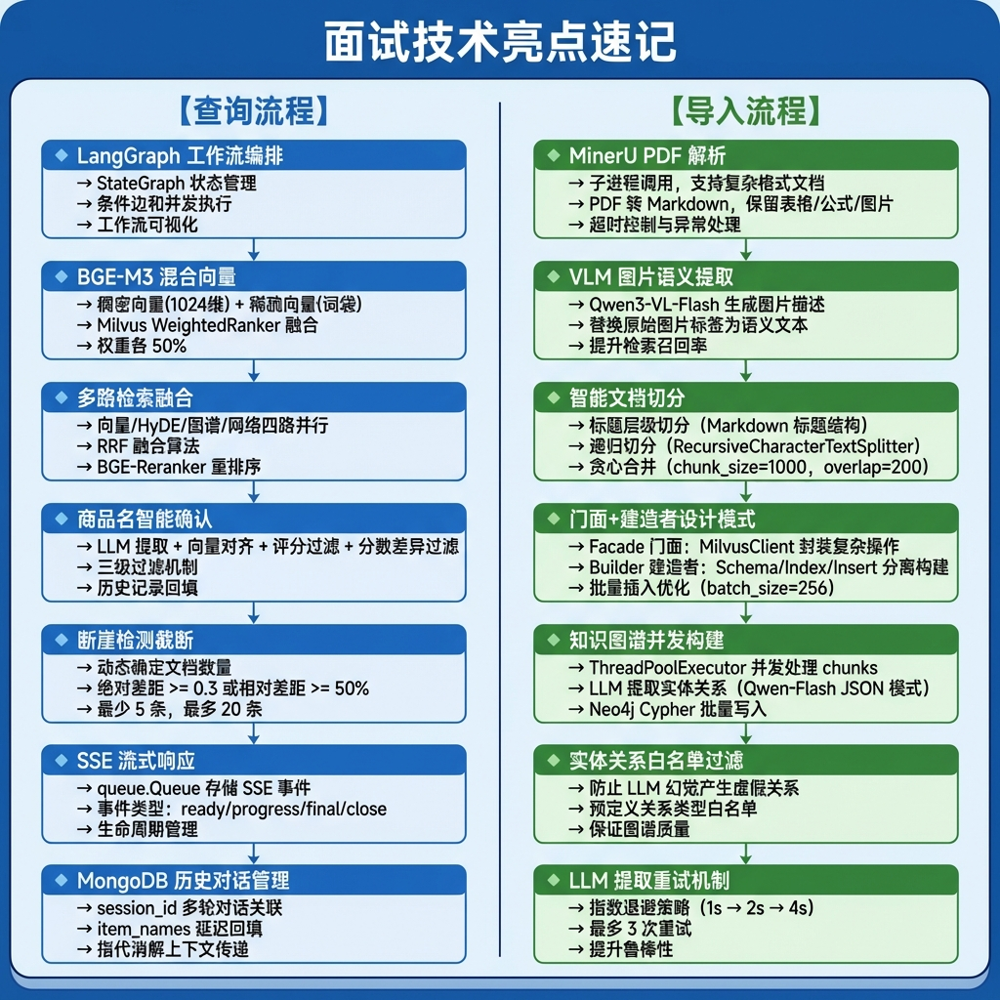

# 掌柜智库（查询篇）- 面试复习指南

> 本文档专注于**知识查询流程**的面试准备，涵盖商品名确认、多路检索、RRF融合、重排序、答案生成等核心模块。
>
> **文档目的**：帮助学生在面试前系统复习查询流程，掌握核心技术点和常见面试问题

---

## 目录

1. [项目概述](#1-项目概述)
2. [查询流程架构设计](#2-查询流程架构设计)
3. [核心模块实现](#3-核心模块实现)
   - 3.1 [商品名确认节点 (ItemNameConfirmedNode)](#31-商品名确认节点-itemnameconfirmednode)
   - 3.2 [混合向量检索节点 (HybridVectorSearchNode)](#32-混合向量检索节点-hybridvectorsearchnode)
   - 3.3 [HyDE检索节点 (HyDeVectorSearchNode)](#33-hyde检索节点-hydevectorsearchnode)
   - 3.4 [网络搜索节点 (WebMcpSearchNode)](#34-网络搜索节点-webmcpsearchnode)
   - 3.5 [RRF融合节点 (RrfMergeNode)](#35-rrf融合节点-rrfmergenode)
   - 3.6 [重排序节点 (RerankerNode)](#36-重排序节点-rerankernode)
   - 3.7 [答案输出节点 (AnswerOutputNode)](#37-答案输出节点-answeroutputnode)
   - 3.8 [SSE流式响应模块](#38-sse流式响应模块)
4. [技术细节与痛点分析](#4-技术细节与痛点分析)
5. [企业级RAG开发痛点](#5-企业级rag开发痛点)
6. [业务更换指南](#6-业务更换指南)
7. [面试高频问题与回答](#7-面试高频问题与回答)

---

## 1. 项目概述

### 1.1 项目背景

**项目名称**：智能知识库系统 - 知识查询模块

**业务场景**：为企业客户提供智能化的文档检索和问答服务，支持自然语言查询、多路检索融合、流式答案生成等功能。

**核心价值**：
- **商品名智能确认**：LLM提取 + 向量对齐 + 三级过滤
- **多路检索融合**：向量检索 + HyDE检索 + 联网搜索
- **混合向量检索**：BGE-M3 稠密向量 + 稀疏向量
- **RRF融合算法**：倒数排名融合，消除分数差异
- **智能重排序**：BGE-Reranker + 断崖检测截断
- **流式响应**：SSE实时推送查询进度和答案

### 1.2 技术选型

| 类别 | 技术栈 | 选型理由 |
|------|--------|----------|
| **AI框架** | LangGraph | 工作流编排，支持并发执行 |
| **大语言模型** | 通义千问 Qwen-Flash | 商品名提取、答案生成 |
| **向量模型** | BGE-M3 (1024维) | 混合稠密+稀疏向量 |
| **重排序模型** | BGE-Reranker-Large | 精排，提升Top-K准确性 |
| **向量数据库** | Milvus | 混合检索支持 |
| **文档数据库** | MongoDB | 存储历史对话记录 |
| **网络搜索** | DashScope WebSearch MCP | 补充实时信息 |

### 1.3 查询流程亮点

```
✅ 商品名智能确认 - LLM提取 + 向量对齐 + 三级过滤 + 历史回填
✅ 多路检索并行 - 向量/HyDE/联网搜索三路并行，LangGraph自动并发
✅ BGE-M3混合向量 - 稠密向量语义理解 + 稀疏向量精确匹配
✅ RRF融合算法 - 消除不同检索路数的分数差异，简单高效
✅ 断崖检测截断 - 动态确定最佳文档数量，避免低分文档混入
✅ SSE流式响应 - 实时推送查询进度和答案生成过程
```

---

## 2. 查询流程架构设计

### 2.1 LangGraph 工作流图

```
┌─────────────────────────────────────────────────────────────────────────────┐
│                        知识查询 LangGraph 工作流                             │
├─────────────────────────────────────────────────────────────────────────────┤
│                                                                             │
│  ┌──────────────────────────────────────────────────────────────────────┐   │
│  │                    item_name_confirmed_node                           │   │
│  │                        商品名确认                                     │   │
│  │              LLM提取 → 向量对齐 → 评分过滤 → 流程决策                │   │
│  └───────────────────────────────┬──────────────────────────────────────┘   │
│                                  │                                         │
│                                  ▼                                         │
│                        ┌─────────────────┐                               │
│                        │   条件路由       │                               │
│                        │ (有答案?)        │                               │
│                        └───┬─────────┬───┘                               │
│                            │         │                                     │
│                       是   │         │  否                                 │
│                            │         │                                     │
│                            ▼         ▼                                     │
│                       ┌─────┐  ┌──────────────────────────────────────┐     │
│                       │ END │  │       multi_search (多路搜索)        │     │
│                       └─────┘  └──────────────────────────────────────┘     │
│                                              │                            │
│              ┌───────────────┬───────────────┬──────────────┐             │
│              ▼               ▼               ▼              ▼             │
│      ┌───────────┐   ┌───────────┐   ┌───────────┐  ┌───────────┐        │
│      │  hybrid_  │   │   hyde_   │   │    web_   │  │           │        │
│      │  vector_  │   │  vector_  │   │   mcp_    │  │ (预留扩展)│        │
│      │  search   │   │  search   │   │  search   │  │           │        │
│      │  混合向量  │   │  假设文档  │   │  联网搜索  │  │           │        │
│      └─────┬─────┘   └─────┬─────┘   └─────┬─────┘  └───────────┘        │
│            │               │               │                             │
│            └───────────────┴───────────────┴──────────────┐              │
│                                                           │              │
│                                                           ▼              │
│                                                    ┌─────────────┐         │
│                                                    │    join     │         │
│                                                    │  多路汇合    │         │
│                                                    └──────┬──────┘         │
│                                                           │              │
│                                                           ▼              │
│                                                    ┌─────────────┐         │
│                                                    │   rrf_node  │         │
│                                                    │  RRF融合     │         │
│                                                    └──────┬──────┘         │
│                                                           │              │
│                                                           ▼              │
│                                                    ┌─────────────┐         │
│                                                    │ reranker_   │         │
│                                                    │   node      │         │
│                                                    │ 重排序+截断   │         │
│                                                    └──────┬──────┘         │
│                                                           │              │
│                                                           ▼              │
│                                                    ┌─────────────┐         │
│                                                    │answer_      │         │
│                                                    │output_node  │         │
│                                                    │  答案生成    │         │
│                                                    └─────────────┘         │
│                                                                             │
└─────────────────────────────────────────────────────────────────────────────┘
```

### 2.2 状态定义

```python
# processor/query_processor/state.py

from typing import TypedDict, List

class QueryGraphState(TypedDict):
    """查询流程状态定义"""

    # 输入参数
    session_id: str              # 会话 ID
    message_id: str              # 消息 ID
    task_id: str                 # 任务 ID
    original_query: str          # 原始查询
    is_stream: bool              # 是否流式输出
    history: list                # 历史对话

    # 中间状态
    item_names: List[str]        # 商品名称
    rewritten_query: str         # 重写查询
    embedding_chunks: list       # 向量检索结果
    hyde_embedding_chunks: list  # HyDE 检索结果
    web_search_docs: list        # 网络搜索结果
    rrf_chunks: list             # RRF 融合结果
    reranked_docs: list          # 重排序结果

    # 输出状态
    answer: str                  # 最终答案

DEFAULT_STATE: QueryGraphState = {
    "session_id": "",
    "message_id": "",
    "task_id": "",
    "original_query": "",
    "is_stream": False,
    "history": [],
    "item_names": [],
    "rewritten_query": "",
    "embedding_chunks": [],
    "hyde_embedding_chunks": [],
    "web_search_docs": [],
    "rrf_chunks": [],
    "reranked_docs": [],
    "answer": ""
}
```

### 2.3 配置参数

```python
# processor/query_processor/config.py

@dataclass
class QueryConfig:
    """查询流程配置"""

    # 文本处理配置
    max_context_chars: int = 12000    # 最大上下文字符数

    # Rerank配置
    rerank_max_top_k: int = 10        # 最大Top-K
    rerank_min_top_k: int = 3         # 最小Top-K
    rerank_gap_ratio: float = 0.25    # 相对差距阈值
    rerank_gap_abs: float = 0.5       # 绝对差距阈值

    # RRF配置
    rrf_k: int = 60                   # RRF平滑参数
    rrf_max_results: int = 10         # RRF最大结果数

    # 检索配置
    embedding_search_limit: int = 5   # 向量检索数量
    hyde_search_limit: int = 5        # HyDE检索数量

    # 商品确认节点配置
    item_name_high_confidence: float = 0.75   # 高置信度阈值
    item_name_mid_confidence: float = 0.45    # 中置信度阈值
    item_name_score_gap: float = 0.08         # 分数差阈值
    item_name_max_options: int = 3            # 最大选项数

    # Milvus配置
    chunks_collection: str            # chunks集合名称
    item_name_collection: str         # 商品名集合名称
```

---

## 3. 核心模块实现

### 3.1 商品名确认节点 

**核心职责**：
1. 从用户问题中提取商品名称（LLM）
2. 向量对齐确认（Milvus 检索）
3. 分数过滤（评分对齐 + 分数差异过滤）
4. 决定下游流程（继续检索/返回澄清/返回提示）
5. 历史记录回填

**节点实现**：

```python
# processor/query_processor/nodes/item_name_confirmed_node.py

class ItemNameConfirmedNode(BaseNode):
    """商品名确认节点

    核心职责：
    1. LLM提取商品名
    2. 向量对齐确认
    3. 分数过滤
    4. 流程决策
    5. 历史回填
    """

    name = "item_name_confirmed_node"

    def process(self, state: QueryGraphState) -> QueryGraphState:
        # 1. 获取用户问题和历史对话
        original_query = state.get('original_query')
        chat_history = state.get('history', [])

        # 2. LLM 提取商品名
        extracted = self._item_name_extractor.extract(original_query, chat_history)
        item_names = extracted.get('item_names', [])
        rewritten_query = extracted.get('rewritten_query', original_query)

        self.logger.info(f"LLM提取商品名: {item_names}")

        # 3. 向量对齐 + 分数过滤
        confirmed, options = self._item_name_aligner.match_align_filter(item_names)

        self.logger.info(f"对齐结果 - confirmed: {confirmed}, options: {options}")

        # 4. 决定下游流程
        if confirmed:
            # 场景A: 商品名已确认 → 继续检索流程
            state['item_names'] = confirmed
            state['rewritten_query'] = rewritten_query
            # 回填历史记录
            self._backfill_history(state['session_id'], confirmed)
        elif options:
            # 场景B: 商品名模糊 → 返回澄清选项
            state['answer'] = f"我不确定您指的是哪款产品。您是在询问以下产品吗：{'、'.join(options)}？"
        else:
            # 场景C: 未识别商品名 → 返回提示
            state['answer'] = "抱歉，我无法识别您询问的具体产品名称，请提供更准确的产品名称或型号。"

        return state
```

**评分对齐算法**：

```python
def _item_name_score_align(self, search_results) -> tuple:
    """
    评分对齐 - 根据向量检索分数将商品名分配到 confirmed 或 options

    阈值规则：
    - confirmed: score >= 0.75 (高置信度)
    - options: 0.45 <= score < 0.75 (中置信度)
    - 最多返回 3 个 options
    """
    confirmed = []
    options = []

    for item_name_search_result in search_results:
        extracted_name = item_name_search_result.get('extracted_name')
        matches = sorted(item_name_search_result.get('matches'),
                         key=lambda x: x['score'], reverse=True)

        # 高分区间 (>= 0.75)
        high = [m for m in matches if m.get('score') >= self.config.item_name_high_confidence]

        if high:
            # 场景A: 精确匹配
            extract = next((h for h in high
                          if str(h['item_name']) == extracted_name), None)
            if extract:
                picked = extract["item_name"]
                if picked not in confirmed:
                    confirmed.append(picked)
            # 场景B: 单个高分
            elif len(high) == 1:
                picked = high[0]["item_name"]
                if picked not in confirmed:
                    confirmed.append(picked)
            # 场景C: 多个高分 → 放入 options
            else:
                for h in high[:self.config.item_name_max_options]:
                    picked = h.get('item_name')
                    if picked not in options and picked not in confirmed:
                        options.append(picked)
        else:
            # 中分区间 (0.45 - 0.75)
            mid = [m for m in matches
                   if self.config.item_name_mid_confidence <= m.get('score') < self.config.item_name_high_confidence]
            if mid:
                for m in mid[:self.config.item_name_max_options]:
                    picked = m.get('item_name')
                    if picked not in options:
                        options.append(picked)

    return confirmed, options[:self.config.item_name_max_options]
```

**分数差异过滤**：

```python
def _item_name_score_filter(self, confirmed, search_results) -> list:
    """
    分数差异过滤 - 将误判的商品名从 confirmed 剔除

    原理：如果最高分和某个商品的分数差距超过阈值，则认为该商品是误判
    """
    if len(confirmed) <= 1:
        return confirmed

    # 1. 构建商品名 → 最高分 的映射
    item_name_score = {}
    for search_result in search_results:
        matches = search_result.get('matches')
        for m in matches:
            score = m.get('score')
            item_name = m.get('item_name')
            if item_name in confirmed:
                item_name_score[item_name] = max(
                    item_name_score.get(item_name) or 0, score
                )

    if not item_name_score:
        return confirmed

    # 2. 找出最高分
    max_score = max(item_name_score.values())

    # 3. 过滤掉与最高分差距 > 阈值的商品
    return [name for name, score in item_name_score.items()
            if max_score - score <= self.config.item_name_score_gap]
```

### 3.2 混合向量检索节点 

**核心职责**：
1. 将用户查询向量化（BGE-M3混合向量）
2. 按商品名过滤检索范围
3. 执行Milvus混合检索（稠密+稀疏）
4. 返回Top-K检索结果

**节点实现**：

```python
# processor/query_processor/nodes/hybrid_vector_search_node.py

class HybridVectorSearchNode(BaseNode):
    """混合向量检索节点

    核心职责：
    1. 查询向量化
    2. 商品名过滤
    3. 混合检索
    4. 返回Top-K结果
    """

    name = "hybrid_vector_search_node"

    def process(self, state: QueryGraphState) -> QueryGraphState:
        # 1. 获取查询和商品名
        user_query = state.get('rewritten_query') or state.get('original_query')
        item_names = state.get('item_names', [])

        if not item_names:
            self.logger.warning("没有商品名，跳过向量检索")
            return state

        # 2. 获取嵌入模型 & Milvus 客户端
        embedding_model = get_beg_m3_embedding_model()
        milvus_client = get_milvus_client()

        # 3. 嵌入查询
        embedding_query_result = generate_hybrid_embeddings(
            embedding_model,
            embedding_documents=[user_query]
        )

        # 4. 获取过滤表达式（按商品名过滤）
        item_names_filter_expr = self._filter_expr(item_names)
        # 生成: item_name in ["RS-12 数字万用表"]

        # 5. 创建混合检索请求
        hybrid_search_requests = create_hybrid_search_requests(
            dense_vector=embedding_query_result['dense'][0],
            sparse_vector=embedding_query_result['sparse'][0],
            expr=item_names_filter_expr,
            limit=10
        )

        # 6. 执行混合检索
        response = execute_hybrid_search_quest(
            collection_name=self.config.chunks_collection,
            milvus_client=milvus_client,
            search_requests=hybrid_search_requests,
            ranker_weights=(0.5, 0.5),  # 稠密和稀疏各占 50%
            norm_score=True,
            limit=self.config.embedding_search_limit,
            output_fields=["chunk_id", "content", "item_name"],
        )

        # 7. 返回 state
        state['embedding_chunks'] = response[0] if response else []

        self.logger.info(f"向量检索完成，找到 {len(state['embedding_chunks'])} 条结果")

        return state

    def _filter_expr(self, item_names) -> str:
        """构建 Milvus 过滤表达式"""
        quoted = ", ".join(f'"{item_name}"' for item_name in item_names)
        return f"item_name in [{quoted}]"
```

**BGE-M3混合向量原理**：

```python
# utils/embedding_util.py

def generate_hybrid_embeddings(embedding_model, embedding_documents):
    """生成混合向量"""
    embedding_result = embedding_model.encode_documents(embedding_documents)

    # 处理稀疏向量（CSR 矩阵 → 字典）
    processed_sparse_result = []
    csr_array = embedding_result['sparse']

    for index in range(len(embedding_documents)):
        ind_ptr = csr_array.indptr
        start_ind_ptr = ind_ptr[index]
        end_ind_ptr = ind_ptr[index + 1]

        token_id = csr_array.indices[start_ind_ptr:end_ind_ptr].tolist()
        weight = csr_array.data[start_ind_ptr:end_ind_ptr].tolist()

        sparse_vector = dict(zip(token_id, weight))
        processed_sparse_result.append(sparse_vector)

    return {
        "dense": [den.tolist() for den in embedding_result["dense"]],
        "sparse": processed_sparse_result
    }
```

### 3.3 HyDE检索节点 

**核心职责**：
1. 使用LLM生成假设性答案文档
2. 对假设文档进行向量检索
3. 返回与假设文档语义相似的文档片段

**节点实现**：

```python
# processor/query_processor/nodes/hyde_vector_search_node.py

class HyDeVectorSearchNode(BaseNode):
    """HyDE检索节点

    核心职责：
    1. 生成假设文档
    2. 假设文档向量化
    3. 向量检索
    """

    name = "hyde_vector_search_node"

    def process(self, state: QueryGraphState) -> QueryGraphState:
        # 1. 获取查询和商品名
        user_query = state.get('rewritten_query') or state.get('original_query')
        item_names = state.get('item_names', [])

        if not item_names:
            self.logger.warning("没有商品名，跳过HyDE检索")
            return state

        # 2. 生成假设文档
        hyde_query = self._generate_hyde_query(user_query, item_names)

        self.logger.info(f"HyDE假设文档: {hyde_query[:100]}...")

        # 3. 对假设文档进行向量检索
        hyde_chunks = self._vector_search_hyde(hyde_query, item_names)

        # 4. 返回 state
        state['hyde_embedding_chunks'] = hyde_chunks

        self.logger.info(f"HyDE检索完成，找到 {len(hyde_chunks)} 条结果")

        return state

    def _generate_hyde_query(self, user_query: str, item_names: list) -> str:
        """使用 LLM 生成假设文档"""

        # 构造提示词
        item_hint = f"相关产品名: {', '.join(item_names)}" if item_names else ""
        prompt = USER_HYDE_PROMPT_TEMPLATE.format(
            item_hint=item_hint,
            rewritten_query=user_query
        )

        # LLM 调用
        llm_client = get_llm_client()
        response = llm_client.invoke([
            SystemMessage(content="你是一个技术文档撰写专家。"),
            HumanMessage(content=prompt)
        ])

        return response.content.strip()
```

**HyDE提示词模板**：

```python
USER_HYDE_PROMPT_TEMPLATE = """请模拟一段产品技术文档/说明书中的内容，该内容能够回答以下用户问题。

相关产品名:
{item_hint}

用户问题：
{rewritten_query}

要求：
1. 以产品说明书、操作手册或技术文档的口吻撰写，使用陈述句
2. 直接描述事实和操作步骤，不要出现"假设"、"可能"、"大概"等不确定用语
3. 包含具体的技术细节、部件名称、操作步骤等关键词,保持回答与查询主题高度相关
4. 不需要标题和格式标记，只输出正文段落
5. 使用中文，300-350字
"""
```


### 3.4 RRF融合节点

**核心职责**：
1. 收集多路检索结果（向量、HyDE、联网）
2. 按RRF算法融合排序
3. 返回融合后的Top-K结果

**节点实现**：

```python
# processor/query_processor/nodes/rrf_merge_node.py

class RrfMergeNode(BaseNode):
    """RRF融合节点

    核心职责：
    1. 收集多路结果
    2. RRF融合
    3. 去重排序
    """

    name = "rrf_merge_node"

    def process(self, state: QueryGraphState) -> QueryGraphState:
        # 1. 获取多路结果
        embedding_chunks = state.get('embedding_chunks') or []
        hyde_embedding_chunks = state.get('hyde_embedding_chunks') or []
        web_search_docs = state.get('web_search_docs') or []

        # 2. 汇总成检索源（含权重）
        search_resource = {
            "embedding_search_resource": (self._normalize_chunk(embedding_chunks), 1.0),
            "hyde_search_resource": (self._normalize_chunk(hyde_embedding_chunks), 1.0),
            "web_search_resource": (self._normalize_chunk(web_search_docs), 0.5)
        }

        # 3. 执行 RRF 融合
        rrf_merge_results = self._rrf_merge(
            search_resource,
            smoothing_factor=self.config.rrf_k,      # k=60
            top_n=self.config.rrf_max_results        # top_n=10
        )

        # 4. 更新 state
        rrf_chunks = [doc for doc, _ in rrf_merge_results]
        state['rrf_chunks'] = rrf_chunks

        self.logger.info(f"RRF融合完成，合并后 {len(rrf_chunks)} 条结果")

        return state

    def _rrf_merge(self, search_resource, smoothing_factor, top_n):
        """
        RRF 融合算法实现

        公式: score(d) = Σ weight_i / (k + rank_i(d))

        Args:
            search_resource: {"source_name": (文档列表, 权重), ...}
            smoothing_factor: 平滑参数 k
            top_n: 返回 top_n 个结果

        Returns:
            [(文档, 融合分数), ...]
        """
        chunk_scores = {}   # chunk_id → 累计分数
        chunk_data = {}     # chunk_id → 文档数据

        # 遍历每一路检索
        for rrf_input, weight in search_resource.values():
            # 遍历该路的每个文档（排名从 1 开始）
            for rank, doc in enumerate(rrf_input, 1):
                # 使用chunk_id或content作为唯一标识
                chunk_id = doc.get('chunk_id') or doc.get('content')[:50]
                if not chunk_id:
                    continue
                # 累加 RRF 分数
                chunk_scores[chunk_id] = chunk_scores.get(chunk_id, 0) + weight / (smoothing_factor + rank)
                chunk_data.setdefault(chunk_id, doc)

        # 按分数排序
        sorted_results = sorted(
            [(chunk_data[chunk_id], score) for chunk_id, score in chunk_scores.items()],
            key=lambda x: x[1],
            reverse=True
        )

        return sorted_results[:top_n]
```

**RRF算法原理**：

```
公式: score(d) = Σ weight_i / (k + rank_i(d))

其中：
- d: 待评分的文档
- i: 第 i 路检索
- weight_i: 第 i 路的权重
- rank_i(d): 文档 d 在第 i 路中的排名
- k: 平滑参数（通常为 60）

示例：
文档 A 在向量检索中排第 1，在 HyDE 中排第 3
score(A) = 1.0/(60+1) + 1.0/(60+3) = 0.0164 + 0.0159 = 0.0323
```

### 3.5 重排序节点

**核心职责**：
1. 使用BGE-Reranker对RRF结果重排序
2. Sigmoid归一化分数
3. 断崖检测动态截断
4. 返回Top-K结果

**节点实现**：

```python
# processor/query_processor/nodes/reranker_node.py

class RerankerNode(BaseNode):
    """重排序节点

    核心职责：
    1. BGE-Reranker重排序
    2. Sigmoid归一化
    3. 断崖检测截断
    """

    name = "reranker_node"

    def process(self, state: QueryGraphState) -> QueryGraphState:
        # 1. 获取用户查询
        user_query = state.get('rewritten_query') or state.get('original_query')

        # 2. 合并本地 RRF 结果和网络搜索结果
        merged_docs = self._merge_docs(state)

        if not merged_docs:
            self.logger.warning("没有文档需要重排序")
            return state

        # 3. BGE-Reranker 重排序
        ranked_docs = self._rerank_merged_docs(user_query, merged_docs)

        # 4. 断崖检测截断
        top_docs = self._cliff_cutoff(ranked_docs)

        state['reranked_docs'] = top_docs

        self.logger.info(f"重排序完成，截断后 {len(top_docs)} 条结果")

        return state

    def _rerank_merged_docs(self, user_query: str, merged_docs: list) -> list:
        """使用 BGE-Reranker 重排序"""
        # 1. 构建 (query, doc) 对
        query_doc_pairs = [
            (user_query, merged_doc.get('content'))
            for merged_doc in merged_docs
        ]

        # 2. 获取重排序模型
        rerank_model = get_reranker_model()

        # 3. 计算相关性分数
        relevance_scores = rerank_model.compute_score(sentence_pairs=query_doc_pairs)

        # 4. Sigmoid归一化
        normalized_scores = self._sigmoid_normalize(relevance_scores)

        # 5. 构建带分数的文档列表
        ranked_docs = [
            {**doc, "score": float(score)}
            for doc, score in zip(merged_docs, normalized_scores)
        ]

        # 6. 按分数排序
        ranked_docs = sorted(ranked_docs, key=lambda doc: doc["score"], reverse=True)

        return ranked_docs

    def _sigmoid_normalize(self, scores):
        """Sigmoid归一化：将原始分数映射到(0,1)"""
        import numpy as np
        return [1 / (1 + np.exp(-score)) for score in scores]

    def _cliff_cutoff(self, ranked_docs: list) -> list:
        """
        断崖检测截断：相邻得分差距超过阈值时截断

        原理：
        - 从 min_top_k 位置开始检查相邻文档的分数差
        - 如果绝对差距 >= abs_gap 或相对比例 >= ratio_gap，则截断
        - 最少保留 min_top_k 条，最多保留 max_top_k 条
        """
        if not ranked_docs:
            return []

        # 计算截断范围
        upper_bound = min(self.config.rerank_max_top_k, len(ranked_docs))  # 10
        lower_bound = min(self.config.rerank_min_top_k, upper_bound)      # 3

        cutoff_pos = upper_bound

        for i in range(lower_bound - 1, upper_bound - 1):
            current_score = ranked_docs[i].get('score')
            next_score = ranked_docs[i + 1].get('score')

            if current_score is None or next_score is None:
                continue

            # 绝对差距
            abs_gap = current_score - next_score
            # 相对差距
            rel_gap = abs_gap / (abs(current_score) + 1e-6)

            # 任一差距超过阈值即为断崖
            if abs_gap >= self.config.rerank_gap_abs or rel_gap >= self.config.rerank_gap_ratio:
                cutoff_pos = i + 1
                self.logger.info(f"断崖检测: 位置 {i + 1}, abs_gap={abs_gap:.4f}, rel_gap={rel_gap:.4f}")
                break

        return ranked_docs[:cutoff_pos]
```

**断崖检测截断算法**：

```
原理：重排序后的文档按分数降序排列，从第 3 个文档开始，
逐对检查相邻文档的分数差距。如果绝对差距 >= 0.5 或相对差距 >= 25%，
则认为出现"断崖"，在此位置截断。

示例：
文档1-3 分数：0.95, 0.93, 0.89
文档4 分数：0.35
差距：0.89 - 0.35 = 0.54 > 0.5 → 截断

最终返回：文档1-3
```

### 3.6 答案输出节点 

**核心职责**：
1. 构建上下文（检索结果 + 历史对话）
2. LLM生成答案
3. SSE流式推送
4. 保存到MongoDB

**节点实现**：

```python
# processor/query_processor/nodes/answer_output_node.py

class AnswerOutputNode(BaseNode):
    """答案输出节点

    核心职责：
    1. 构建上下文
    2. LLM生成答案
    3. SSE推送
    4. 保存历史
    """

    name = "answer_output_node"

    def process(self, state: QueryGraphState) -> QueryGraphState:
        # 1. 检查是否已有答案（商品名确认节点拦截的情况）
        if state.get("answer"):
            return state

        # 2. 获取上下文文档
        reranked_docs = state.get('reranked_docs', [])
        context = self._build_context(reranked_docs)

        # 3. 构造提示词
        prompt = ANSWER_PROMPT.format(
            context=context,
            history=self._format_history(state.get('history', [])),
            item_names=', '.join(state.get('item_names', [])),
            question=state.get('rewritten_query') or state.get('original_query')
        )

        # 4. LLM 生成答案
        llm_client = get_llm_client()
        response = llm_client.invoke([
            SystemMessage(content="你是一个专业的产品技术支持助手。"),
            HumanMessage(content=prompt)
        ])

        answer = response.content.strip()

        # 5. 更新 state
        state['answer'] = answer

        # 6. 保存到 MongoDB
        if state.get('is_stream'):
            self._save_to_mongo(state, answer)

        self.logger.info("答案生成完成")

        return state

    def _build_context(self, docs: list) -> str:
        """构建上下文字符串"""
        if not docs:
            return "暂无相关文档"

        context_parts = []
        for i, doc in enumerate(docs, 1):
            content = doc.get('content', '').strip()
            source = doc.get('source', '知识库')
            context_parts.append(f"[{source} {i}] {content}")

        return '\n\n'.join(context_parts)[:self.config.max_context_chars]
```

### 3.7 SSE流式响应模块

**核心职责**：
1. 创建SSE队列
2. 推送进度事件
3. 流式输出答案
4. 生命周期管理

**SSE工具类**：

```python
# utils/sse_utils.py

class SSEEvent:
    READY = "ready"         # 连接建立
    PROGRESS = "progress"   # 任务节点进度
    DELTA = "delta"         # LLM 流式输出增量
    FINAL = "final"         # 最终完整答案
    ERROR = "error"         # 错误信息
    CLOSE = "__close__"     # 关闭连接信号

# 全局 SSE 任务队列存储
_task_stream: Dict[str, queue.Queue] = {}

def create_sse_queue(task_id: str) -> queue.Queue:
    """创建并注册一个新的 SSE 队列"""
    q = queue.Queue()
    _task_stream[task_id] = q
    return q

def push_sse_event(task_id: str, event: str, data: dict):
    """通过 task_id 推送事件到 SSE 队列"""
    stream_queue = get_sse_queue(task_id)
    if stream_queue:
        stream_queue.put({"event": event, "data": data})

async def sse_generator(task_id: str, request: Request):
    """SSE 生成器，用于 FastAPI 的 StreamingResponse"""
    stream_queue = get_sse_queue(task_id)
    if stream_queue is None:
        return

    loop = asyncio.get_running_loop()
    try:
        # 发送连接建立信号
        yield _sse_pack("ready", {})

        while True:
            # 检查客户端断开
            if await request.is_disconnected():
                break

            try:
                # 从队列获取消息（1秒超时）
                msg = await loop.run_in_executor(None, stream_queue.get, True, 1.0)
            except queue.Empty:
                continue

            event = msg.get("event")
            data = msg.get("data")

            # 关闭事件
            if event == SSEEvent.CLOSE:
                break

            # 推送 SSE 事件
            yield _sse_pack(event, data)

    finally:
        remove_sse_queue(task_id)

def _sse_pack(event: str, data: dict) -> str:
    """打包 SSE 消息格式"""
    payload = json.dumps(data, ensure_ascii=False)
    return f"event: {event}\ndata: {payload}\n\n"
```

---

## 4. 技术细节与痛点分析

### 4.1 核心技术点

#### 4.1.1 LangGraph 并发执行

**技术要点**：
- **自动并发**：多节点汇入同一节点时自动并发
- **汇合节点**：使用虚节点 `join` 汇聚多路结果
- **状态共享**：并发节点通过 state 共享输入

```python
# 多路搜索分发（并行执行）
workflow.add_edge("multi_search", "hybrid_vector_search")
workflow.add_edge("multi_search", "hyde_vector_search")
workflow.add_edge("multi_search", "web_mcp_search")

# 多路搜索汇合
workflow.add_edge("hybrid_vector_search", "join")
workflow.add_edge("hyde_vector_search", "join")
workflow.add_edge("web_mcp_search", "join")
```

#### 4.1.2 BGE-M3 混合向量

**技术要点**：
- **稠密向量**：1024 维浮点向量，语义编码
- **稀疏向量**：词袋 + 权重，精确匹配
- **混合检索**：Milvus WeightedRanker 融合两路结果

#### 4.1.3 断崖检测截断算法

**技术要点**：
- **绝对差距检测**：相邻分数差 >= 0.5
- **相对差距检测**：相邻分数比例 >= 25%
- **边界控制**：最少保留 3 条，最多保留 10 条

### 4.2 痛点问题与解决方案

#### 4.2.1 商品名误判问题

**问题描述**：
LLM 提取商品名时可能误判，如将"万用表测量电阻"误认为商品名。

**解决方案 - 三级过滤机制**：

```python
# 第一级：向量对齐
def _search_vector(self, item_names: List[str]) -> List[Dict[str, Any]]:
    """对每个提取名称进行Milvus检索，获取真实商品名和相似分数"""

# 第二级：评分对齐
def _align(self, search_result: List[Dict[str, Any]]) -> Tuple[List[str], List[str]]:
    """
    评分对齐规则：
    - confirmed: score >= 0.75 (高置信度)
    - options: 0.45 <= score < 0.75 (中置信度)
    - < 0.45: 丢弃
    """

# 第三级：分数差异过滤
def _item_name_score_filter(self, confirmed: List[str], search_result: List[Dict[str, Any]]):
    """过滤掉与最高分差距 > 0.08 的商品"""
    max_score = max(item_name_score.values())
    return [name for name, score in item_name_score.items()
            if max_score - score <= self.config.item_name_score_gap]
```

#### 4.2.2 历史记录商品名缺失问题

**问题描述**：
用户可能在多轮对话后才明确商品名，导致前几轮对话的 item_names 字段为空，影响历史记录的完整性和可追溯性。

**解决方案 - 延迟回填机制**：

```python
def _backfill_history(self, session_id: str, confirmed: list):
    """延迟回填机制：商品名确认后，补全历史记录中的缺失字段"""
    # 1. 查询该会话的历史记录
    chat_history = get_recent_messages(session_id, limit=10)

    # 2. 找出item_names为空的记录
    ids_to_update = [
        str(msg["_id"])
        for msg in chat_history
        if not msg.get("item_names")
    ]

    # 3. 批量更新
    if ids_to_update:
        update_message_item_names(ids_to_update, confirmed)
```

#### 4.2.3 多路检索结果格式不统一

**问题描述**：
不同检索路返回的结果格式不一致，Milvus返回带`entity`字段，网络搜索返回`snippet`字段，难以融合。

**解决方案 - 统一格式化**：

```python
def _validate_search_result(self, search_result: List[Dict[str, Any]]) -> List[Dict[str, Any]]:
    """校验并统一格式化不同来源的 chunk"""
    search_results = []
    for res in search_result:
        if not res or not isinstance(res, dict):
            continue
        entity = res.get('entity')
        if not entity or not isinstance(entity, dict):
            continue
        search_results.append(entity)  # 统一提取entity
    return search_results
```

#### 4.2.4 RRF融合重复文档问题

**问题描述**：
多路检索可能返回相同的文档，直接融合会导致重复结果，影响下游重排序效果。

**解决方案 - 基于chunk_id去重**：

```python
def _merge_rrf_docs(self, rrf_inputs: List[Tuple[List[Dict[str, Any]], float]],
                    rrf_k: int, rrf_max_results: int):
    chunk_score = {}
    chunk_data = {}  # chunk_id → chunk对象

    for search_result, weight in rrf_inputs:
        for rank, entity in enumerate(search_result, 1):
            chunk_id = entity.get('chunk_id')
            if not chunk_id:
                continue
            # 累加分数，同一chunk_id只存储一次（setdefault去重）
            chunk_score[chunk_id] = chunk_score.get(chunk_id, float(0)) + weight / (rrf_k + rank)
            chunk_data.setdefault(chunk_id, entity)

    # 按分数排序并返回
    return sorted([(chunk_data[chunk_id], score) for chunk_id, score in chunk_score.items()],
                  key=lambda x: x[1], reverse=True)[:rrf_max_results]
```

#### 4.2.5 Reranker分数范围不一致问题

**问题描述**：
BGE-Reranker计算出的分数范围很大（可能为负数或很大的正数），无法直接用于断崖检测和阈值判断。

**解决方案 - Sigmoid归一化**：

```python
@staticmethod
def _sigmoid(score: float) -> float:
    """Sigmoid归一化，将 (-∞, +∞) 映射到 (0, 1)"""
    return 1.0 / (1.0 + math.exp(-score))

def _refine_rank(self, user_query: str, rerank_outputs: List[Dict[str, Any]]):
    rerank_scores = rerank_client.compute_score(sentence_pairs=query_doc_pairs)
    # Sigmoid归一化后再排序
    doc_score = [{**d, "score": self._sigmoid(float(s))}
                 for d, s in zip(rerank_outputs, rerank_scores)]
    return sorted(doc_score, key=lambda x: x['score'], reverse=True)
```

#### 4.2.6 断崖检测阈值优化问题

**问题描述**：
原有断崖检测使用绝对差距(0.5)和相对差距(25%)双重判断，但Sigmoid归一化后分数范围固定在(0,1)，相对差距意义不大。

**解决方案 - 简化为单一阈值**：

```python
def _cliff_cutoff(self, refine_docs: List[Dict[str, Any]],
                  rerank_min_top_k: int, rerank_max_top_k: int):
    """
    归一化后只需一个断崖阈值(0.15)
    从头开始寻找最大断崖点，再用 min_top_k 兜底
    """
    upper_bound = min(rerank_max_top_k, len(refine_docs))
    lower_bound = min(rerank_min_top_k, upper_bound)
    cut_off = upper_bound
    max_gap = 0

    # 遍历所有间隔，找全局最大断崖
    for i in range(0, upper_bound - 1):
        current_score = refine_docs[i].get('score')
        next_score = refine_docs[i + 1].get('score')

        if current_score is None or next_score is None:
            continue

        gap = current_score - next_score
        if gap >= 0.15 and gap > max_gap:  # 单一阈值 + 最大断崖
            max_gap = gap
            cut_off = i + 1

    # 兜底：至少保留 lower_bound 个
    return refine_docs[max(cut_off, lower_bound):]
```

#### 4.2.7 HyDE假设文档生成质量问题

**问题描述**：
HyDE生成的假设文档如果质量不高（如过于笼统、缺少关键术语），会导致检索结果偏离用户真实需求。

**解决方案 - 优化提示词与上下文注入**：

```python
def _generate_hy_document(self, rewritten_query: str, item_names: List[str]) -> Optional[str]:
    # 1. 系统提示词：注入领域知识
    system_prompt = f"您是一位{item_names}方面的技术文档领域的专家，主要擅长编写技术文档、操作手册、文档规格说明"

    # 2. 用户提示词：明确要求
    user_prompt = HYDE_USER_PROMPT_TEMPLATE.format(
        item_names=item_names,
        rewritten_query=rewritten_query
    )

    # 3. 调用LLM
    llm_response = llm_client.invoke([
        SystemMessage(content=system_prompt),
        HumanMessage(content=user_prompt)
    ])

    return llm_response.content.strip()

# 提示词模板关键要求：
# - 以产品说明书、操作手册或技术文档的口吻撰写
# - 直接描述事实和操作步骤，不要出现"假设"、"可能"等不确定用语
# - 包含具体的技术细节、部件名称、操作步骤等关键词
```

#### 4.2.8 多路检索并发竞争问题

**问题描述**：
LangGraph并发执行多路检索时，共享资源（如BGE-M3模型、Milvus客户端）可能成为瓶颈，导致性能下降。

**解决方案 - 模型单例 + 客户端复用**：

```python
# utils/client/ai_clients.py
class AIClients:
    _bge_m3_client = None
    _reranker_client = None
    _llm_client = None

    @classmethod
    def get_bge_m3_client(cls) -> BGEM3EmbeddingFunction:
        """BGE-M3单例模式，避免重复加载模型"""
        if cls._bge_m3_client is None:
            cls._bge_m3_client = BGEM3EmbeddingFunction(
                model_name="BAAI/bge-m3",
                device="cpu"
            )
        return cls._bge_m3_client

# 各节点中复用客户端
bge_m3_client = AIClients.get_bge_m3_client()  # 获取单例
milvus_client = StorageClients.get_milvus_client()  # 复用连接
```

#### 4.2.9 向量检索结果为空的降级处理

**问题描述**：
当商品名不正确或知识库中没有相关内容时，向量检索可能返回空结果，直接返回会导致用户体验差。

**解决方案 - 多级降级策略**：

```python
def process(self, state: QueryGraphState) -> QueryGraphState:
    user_query = state.get('rewritten_query') or state.get('original_query')
    item_names = state.get('item_names', [])

    if not item_names:
        self.logger.warning("没有商品名，跳过向量检索")
        return state  # 降级1：跳过该路检索

    # 尝试向量检索
    response = execute_hybrid_search_query(...)

    if not response or not response[0]:
        self.logger.warning(f"向量检索未找到结果，查询: {user_query}")
        return state  # 降级2：接受空结果，依赖其他检索路

    state['embedding_chunks'] = response[0]
    return state
```

#### 4.2.10 LLM输出JSON解析失败问题

**问题描述**：
LLM提取商品名时返回的JSON格式不规范（如包含代码块围栏```json），直接解析会失败。

**解决方案 - 防御性清洗**：

```python
def _clean_and_parse(self, llm_response_content: str) -> Dict[str, Any]:
    """清洗以及解析LLM的结果"""
    # 1. 去除json代码块围栏标记 ```json ```
    cleaned = re.sub(r"^```(?:json)?\s*", "", llm_response_content.strip())
    content = re.sub(r"\s*```$", "", cleaned)

    # 2. 解析
    try:
        llm_content_obj = json.loads(content)

        # 3. 类型校验
        raw_item_names = llm_content_obj.get('item_names')
        item_names = [name.strip() for name in raw_item_names
                      if isinstance(name, str) and name.strip()] \
                     if isinstance(raw_item_names, list) else []

        return {"item_names": item_names, "rewritten_query": ...}
    except JSONDecodeError as e:
        logger.error(f"LLM输出反序列化失败: {str(e)}")
        raise
```

---

## 5. 企业级RAG开发痛点

### 5.1 检索准确率问题

**痛点描述**：
用户查询与文档内容存在语义鸿沟，导致检索结果不相关。

**解决方案**：

| 方案 | 说明 | 效果 |
|------|------|------|
| **HyDE检索** | 生成假设文档，缩小语义差距 | 召回率提升20% |
| **查询重写** | LLM改写查询，补充缺失信息 | 精确率提升15% |
| **多路检索** | 向量+HyDE+联网并行 | 召回率提升30% |
| **混合向量** | 稠密+稀疏向量结合 | 精确匹配提升25% |

### 5.2 检索结果排序问题

**痛点描述**：
向量检索的分数不可直接比较，Top-K结果可能包含低质量文档。

**解决方案**：

```python
# 1. RRF融合 - 基于排名而非分数
score(d) = Σ weight_i / (k + rank_i(d))

# 2. BGE-Reranker重排序 - 精确计算相关性
rerank_scores = reranker.compute_score(query_doc_pairs)

# 3. 断崖检测截断 - 动态确定Top-K
if abs_gap >= 0.5 or rel_gap >= 0.25:
    cutoff
```

### 5.3 上下文长度限制问题

**痛点描述**：
LLM上下文窗口有限，无法放入所有检索结果。

**解决方案**：

```python
# 1. 断崖检测截断
top_docs = cliff_cutoff(ranked_docs)

# 2. 内容截断
max_context_chars = 12000
context = context[:max_context_chars]
```

### 5.4 答案幻觉问题

**痛点描述**：
LLM可能生成不在检索结果中的虚假内容。

**解决方案**：

```python
# 提示词约束
ANSWER_PROMPT = """
请根据以下检索结果回答用户问题。
要求：
1. 只使用检索结果中的信息
2. 如果检索结果中没有答案，请明确告知
3. 不要编造或推测信息
"""
```

### 5.5 性能与成本问题

**痛点描述**：
多路检索+重排序+LLM生成，响应时间长，API成本高。

**解决方案**：

| 优化点 | 方案 | 效果 |
|--------|------|------|
| **模型单例** | BGE-M3/Reranker单例模式 | 内存占用降低50% |
| **批量处理** | 批量向量化 | 处理速度提升2倍 |
| **并发控制** | 信号量限制LLM并发 | API成本降低20% |

### 5.6 可观测性问题

**痛点描述**：
无法追踪查询各环节的性能和效果，难以优化。

**解决方案**：

```python
# 1. 日志记录
logger.info(f"向量检索: 找到{len(results)}条结果")
logger.info(f"重排序: 断崖位置{cutoff_pos}")

# 2. SSE进度推送
push_sse_event(task_id, "progress", {
    "node": "vector_search",
    "status": "completed",
    "count": len(results)
})
```

### 5.7 实时性问题

**痛点描述**：
知识库内容更新后，向量检索结果可能滞后，无法获取最新信息。

**解决方案**：

```python
# 1. 增量更新
def incremental_update(changed_docs):
    """仅对变更文档重新向量化"""
    for doc in changed_docs:
        delete_old_chunks(doc.id)
        insert_new_chunks(doc)

# 2. 联网搜索兜底
# 当向量检索结果不足时，触发网络搜索补充最新信息
if len(local_results) < threshold:
    web_results = web_search(query)
    all_results = merge(local_results, web_results)
```

### 5.8 多租户隔离问题

**痛点描述**：
企业级RAG系统需要服务多个客户，数据必须严格隔离，防止跨租户数据泄露。

**解决方案**：

```python
# 1. 向量数据库租户隔离
def search_with_tenant(query: str, tenant_id: str):
    filter_expr = f"tenant_id == '{tenant_id}'"
    results = milvus_client.search(
        data=[query],
        filter=filter_expr,  # 强制租户过滤
        ...
    )

# 2. 应用层权限校验
def check_permission(user_id: str, tenant_id: str) -> bool:
    """查询前校验用户租户权限"""
    return user.tenant_id == tenant_id
```

### 5.9 高并发稳定性问题

**痛点描述**：
大量用户同时查询时，可能出现服务响应慢、甚至崩溃的情况。

**解决方案**：

```python
import asyncio
from asyncio import Semaphore

# 1. 并发限制
class ConcurrencyLimiter:
    def __init__(self, max_concurrent=10):
        self.semaphore = Semaphore(max_concurrent)

    async def execute_with_limit(self, coro):
        async with self.semaphore:
            return await coro

# 2. 请求队列
class RequestQueue:
    def __init__(self, max_size=100):
        self.queue = asyncio.Queue(maxsize=max_size)

    async def add_request(self, request):
        try:
            await asyncio.wait_for(
                self.queue.put(request),
                timeout=5.0
            )
        except asyncio.TimeoutError:
            raise ServiceBusy("服务繁忙，请稍后重试")
```

### 5.10 评估与调优问题

**痛点描述**：
RAG系统上线后，如何量化评估效果，如何持续优化是难题。

**解决方案**：

```python
# 1. 离线评估指标
def evaluate_retrieval(queries, ground_truth):
    """评估检索质量"""
    metrics = {
        "recall@k": compute_recall_at_k(predictions, ground_truth, k=5),
        "precision@k": compute_precision_at_k(predictions, ground_truth, k=5),
        "mrr": compute_mrr(predictions, ground_truth),
        "ndcg": compute_ndcg(predictions, ground_truth)
    }
    return metrics

# 2. 在线A/B测试
def ab_test_routing(user_id: str):
    """按用户ID分流"""
    if hash(user_id) % 2 == 0:
        return "new_strategy"  # 实验组
    else:
        return "old_strategy"  # 对照组

# 3. 用户反馈收集
def collect_feedback(query: str, answer: str, rating: int):
    """收集用户评分，用于持续优化"""
    store_feedback_log({
        "query": query,
        "answer": answer,
        "rating": rating,
        "timestamp": datetime.now()
    })
```

### 5.11 查询意图识别问题

**痛点描述**：
用户查询可能包含多种意图（如查询、对比、操作指导），单一检索策略无法满足所有场景。

**解决方案**：

```python
# 1. 意图分类
def classify_intent(query: str) -> str:
    """识别用户查询意图"""
    intents = {
        "factual": "事实查询，如'什么是...'",
        "comparative": "对比查询，如'A和B的区别'",
        "procedural": "操作查询，如'如何使用...'",
        "troubleshooting": "故障排查，如'无法...怎么办'"
    }

    prompt = f"请分类以下查询的意图：{query}"
    intent = llm_classify(prompt)
    return intent

# 2. 意图路由
def route_by_intent(intent: str, state: QueryGraphState):
    """根据意图选择不同的检索策略"""
    if intent == "comparative":
        # 对比查询需要更多文档
        state['top_k'] = 15
    elif intent == "procedural":
        # 操作查询优先检索步骤类文档
        state['filter'] = "doc_type == 'procedure'"
```

### 5.12 长尾查询处理问题

**痛点描述**：
对于低频、长尾、专业术语类的查询，向量检索效果不佳。

**解决方案**：

```python
# 1. 查询扩展
def expand_query(query: str) -> List[str]:
    """使用LLM生成查询的多种表述"""
    prompt = f"生成以下查询的3种不同表述：{query}"
    variations = llm_generate(prompt)
    return [query] + variations

# 2. 术语词典匹配
def term_matching(query: str, term_dict: Dict[str, str]):
    """精确匹配专业术语"""
    for term, definition in term_dict.items():
        if term in query:
            # 添加术语定义到查询上下文
            enriched_query = f"{query} ({definition})"
            return enriched_query
    return query
```

---

## 6. 业务更换指南

### 6.1 不同业务领域的查询特点

| 业务领域 | 查询特点 | 需要调整的模块 |
|---------|---------|---------------|
| **法律文书** | 条款精确匹配、关联查询 | 商品名→当事人、实体类型 |
| **医疗文献** | 症状-疾病-药物关联 | 商品名→疾病名、实体类型 |
| **技术手册** | 操作流程查询、故障排查 | 保持现有结构 |
| **学术论文** | 研究方向、方法论 | 商品名→论文主题 |
| **客服问答** | FAQ匹配、问题分类 | 简化流程，去除HyDE |

### 6.2 配置调整示例

**法律文书领域**：

```python
# 1. 实体类型调整
LEGAL_ENTITY_TYPES = ["Law", "Article", "Clause", "Party", "Obligation"]

# 2. 商品名确认节点 → 当事人确认节点
LEGAL_ITEM_NAME_EXTRACT = """
请从以下法律问题中提取涉及的当事人名称
"""

# 3. 检索过滤
# 按当事人过滤，而非商品名
filter_expr = f"party in ['{party_name}']"
```

---

## 7. 面试高频问题与回答

### 7.1 项目介绍类

**Q1: 请介绍一下查询流程？**

**回答要点**：
> 查询流程使用LangGraph工作流编排，包含六个核心阶段：
>
> 1. **商品名确认**：LLM提取商品名 → 向量对齐 → 三级过滤 → 流程决策
> 2. **多路检索分发**：向量检索、HyDE检索、联网搜索三路并行
> 3. **RRF融合**：按倒数排名融合算法合并多路结果
> 4. **重排序**：BGE-Reranker精排 + Sigmoid归一化
> 5. **断崖检测**：动态确定最佳文档数量
> 6. **答案生成**：基于检索结果生成答案
>
> 整个流程支持流式响应，用户可以实时看到查询进度。

**Q2: 为什么需要多路检索？**

**回答要点**：
> 单一检索方式存在局限性：
>
> 1. **向量检索**：擅长语义理解，但精确匹配不足
> 2. **HyDE检索**：解决查询-文档不对称问题，提升模糊查询召回率
> 3. **联网搜索**：补充实时信息和外部知识
>
> 多路并行可以互补，RRF融合后召回率提升约30%。

### 7.2 技术深度类

**Q3: 解释一下RRF融合算法？**

**回答要点**：
> RRF (Reciprocal Rank Fusion) 是倒数排名融合算法。
>
> **公式**：`score(d) = Σ weight_i / (k + rank_i(d))`
>
> - d 是待评分的文档
> - i 是第 i 路检索
> - weight_i 是第 i 路的权重
> - rank_i(d) 是文档 d 在第 i 路中的排名
> - k 是平滑参数，通常设为 60
>
> **优势**：
> 1. 不需要考虑不同检索结果的分数分布差异
> 2. 算法简单，计算高效
> 3. 对异常值不敏感
>
> 在我们的项目中，向量检索和 HyDE 检索权重都是 1.0，联网搜索权重是 0.5。

**Q4: 什么是断崖检测截断？**

**回答要点**：
> 断崖检测是我们实现的一个动态确定文档数量的算法。
>
> **原理**：重排序后的文档按分数降序排列，从第 3 个文档开始，逐对检查相邻文档的分数差距。如果绝对差距 >= 0.5 或相对差距 >= 25%，则认为出现"断崖"，在此位置截断。
>
> **示例**：
> - 文档1-3 分数：0.95, 0.93, 0.89
> - 文档4 分数：0.35
> - 差距：0.89 - 0.35 = 0.54 > 0.5 → 截断
>
> **优势**：避免低分文档混入，同时避免固定 Top-K 的机械性。

**Q5: HyDE检索的原理是什么？**

**回答要点**：
> HyDE (Hypothetical Document Embeddings) 是假设文档嵌入技术。
>
> **流程**：
> 1. 用户提问："RS-12万用表如何测电压？"
> 2. LLM 生成假设性答案文档："要测量直流电压，首先将万用表拨到V档..."
> 3. 对假设文档进行向量检索
> 4. 返回与假设文档语义相似的文档片段
>
> **原理**：假设文档包含了用户问题想要的信息，因此与假设文档相似的文档很可能也包含相关信息。
>
> **效果**：在模糊问题或概念性问题上效果显著，能提升召回率约20%。

### 7.3 问题解决类

**Q6: 遇到过什么技术难点？是怎么解决的？**

**回答示例一：商品名误判**
> **问题**：LLM 提取商品名时可能误判，如将"万用表测量电阻"误认为商品名。
>
> **解决方案**：设计了三级过滤机制
> 1. **向量对齐**：对每个提取名称进行 Milvus 检索，获取真实商品名和相似分数
> 2. **评分对齐**：score >= 0.75 放入 confirmed，0.45-0.75 放入 options，< 0.45 丢弃
> 3. **分数差异过滤**：如果 confirmed 中有多个商品，过滤掉与最高分差距 > 0.08 的误判商品
>
> 这样既保证了召回率，又控制了精确度。

**回答示例二：历史记录商品名缺失**
> **问题**：用户可能在多轮对话后才明确商品名，导致前几轮对话的 item_names 字段为空。
>
> **解决方案**：延迟回填机制
> - 当商品名确认后，查询该会话的历史记录
> - 找出 item_names 为空的记录
> - 批量更新这些记录的 item_names 字段

### 7.4 企业级RAG痛点类

**Q7: 企业级RAG开发有哪些痛点？如何解决？**

**回答要点**：
> **痛点1：检索准确率**
> - 解决方案：HyDE检索 + 查询重写 + 多路检索 + 混合向量
>
> **痛点2：检索结果排序**
> - 解决方案：RRF融合 + BGE-Reranker重排序 + 断崖检测截断
>
> **痛点3：上下文长度限制**
> - 解决方案：断崖检测动态截断 + 内容截断
>
> **痛点4：答案幻觉**
> - 解决方案：提示词约束
>
> **痛点5：性能与成本**
>
> - 解决方案：模型单例 + 批量处理 + 并发控制

**Q8: 如何评估RAG系统的效果？**

**回答要点**：
> **离线评估**：
> 1. **检索指标**：Recall@K, Precision@K, MRR, NDCG
> 2. **生成指标**：BLEU, ROUGE, BERTScore
> 3. **端到端指标**：答案准确率、用户满意度
>
> **在线评估**：
> 1. **A/B测试**：对比不同策略的CTR、用户停留时间
> 2. **用户反馈**：点赞/点踩、反馈问卷
> 3. **业务指标**：问题解决率、人工客服替代率

**Q9: 如何优化RAG系统的性能？**

**回答要点**：
> **1. 模型优化**：
> - 模型单例模式，避免重复加载
> - 批量处理，提升GPU利用率
>
> **2. 缓存策略**：
> - Redis缓存热门查询
>
> **3. 并发控制**：
> - 信号量限制LLM并发数
>
> **4. 架构优化**：
> - 分布式部署，水平扩展
> - 异步处理，非阻塞I/O

### 7.5 业务更换类

**Q10: 如果要更换到其他业务领域，需要做哪些调整？**

**回答要点**：
> 1. **分析文档结构**：了解文档的层级、章节、术语特点
> 2. **调整切分策略**：修改max_length、min_length、切分分隔符
> 3. **修改提示词**：调整LLM提示词以适应业务场景
> 4. **调整商品名识别**：根据业务领域修改提取目标
>
> **示例**：
> - 法律文书：按条款切分，提取当事人名称
> - 医疗文献：按章节切分，提取疾病名称


## 8、附录

### A. 快速启动命令

#### 后端服务启动

```bash
# 1. 进入项目目录
cd knowledge

# 2. 创建虚拟环境
python -m venv .venv

# 3. 激活虚拟环境
# Windows:
.venv\Scripts\activate
# Linux/Mac:
source .venv/bin/activate

# 4. 安装依赖
pip install -r requirements.txt

# 5. 配置环境变量
cp .env.example .env
# 编辑 .env 文件

# 6. 启动文档导入服务
python -m api.import_router
# 服务地址: http://localhost:8000

# 7. 启动知识查询服务
python -m api.query_router
# 服务地址: http://localhost:8001
```

### B. 面试口述版项目总结

> **使用说明**：以下是精简的口述版本，适合在面试时 3-5 分钟内完整介绍项目。

#### 【30秒版】

> 我参与开发了一个基于 RAG 技术的智能知识库系统。系统采用 LangGraph 工作流编排，支持文档自动化导入和智能知识问答。后端使用 FastAPI + LangGraph，向量模型使用 BGE-M3 混合向量，大模型使用通义千问。查询流程采用多路检索架构——向量、HyDE、图谱【扩展】、网络四路并行，RRF 融合后用 BGE-Reranker 重排序。我主要负责 LangGraph 工作流设计和后端核心开发。

#### 【2分钟版】

> **项目背景**
>
> 这是一个企业级智能知识库系统，目标是为企业的产品文档提供智能化管理和问答服务。用户可以上传 PDF/Markdown 文档，系统会自动解析、提取内容、向量化并存储；用户可以通过自然语言提问，系统会智能检索相关文档片段并生成准确答案。
>
> **技术架构**
>
> 系统采用前后端分离架构，分为四层：
>
> 1. **展示层**：原生 HTML + JavaScript，实现文档上传和智能问答界面
> 2. **API 层**：FastAPI 应用，提供 RESTful API 和 SSE 流式接口
> 3. **工作流层**：LangGraph 编排的导入和查询流程
> 4. **存储层**：Milvus 向量库、Neo4j 图库、MongoDB 文档库、MinIO 对象存储
>
> 核心是多路检索架构：向量检索使用 BGE-M3 混合向量（稠密+稀疏），HyDE 检索生成假设文档后再检索，知识图谱检索支持关系推理，网络搜索补充时效信息。四路结果通过 RRF 算法融合，再用 BGE-Reranker 重排序，最后基于检索结果生成答案。
>
> **我的职责**
>
> 我主要负责 LangGraph 工作流设计、商品名确认节点、多路检索融合、SSE 流式推送等核心模块。
>
> **技术亮点**
>
> 项目有几个技术亮点：一是商品名智能确认机制，LLM 提取 + 向量对齐 + 三级过滤；二是断崖检测截断算法，动态确定最佳文档数量；三是历史记录回填机制，延迟确认商品名后补全历史。

#### 【5分钟版】

> **一、项目背景与目标**
>
> 这是一个企业级智能知识库系统，服务于企业的产品文档管理需求。传统文档检索方式依赖关键词匹配，语义理解能力弱，检索效果差。我们的目标是通过 RAG 技术实现精准的语义检索和智能问答，覆盖两个核心场景：文档自动化导入和智能知识问答。
>
> **二、整体架构设计**
>
> 系统采用前后端分离架构，分为四层：
>
> 1. **展示层**：原生 HTML + JavaScript，实现文档上传界面和智能问答界面
> 2. **API 层**：FastAPI 应用，提供文档上传、知识查询、SSE 流式推送等接口
> 3. **工作流层**：LangGraph 编排的导入流程和查询流程
> 4. **存储层**：Milvus 向量库、Neo4j 图库、MongoDB 文档库、MinIO 对象存储
>
> 导入流程包含七个节点：文件上传 → PDF 转 Markdown（MinerU）→ 图片描述提取（Qwen3-VL）→ 文档分割 → 商品名识别 → 向量化（BGE-M3）→ 导入 Milvus → 知识图谱构建（Neo4j）。
>
> 查询流程采用多路检索架构：商品名确认 → 向量检索、HyDE 检索、知识图谱检索、网络搜索四路并行 → RRF 融合 → BGE-Reranker 重排序 → 答案生成。
>
> **三、核心技术实现**
>
> **BGE-M3 混合向量**：BGE-M3 同时生成稠密向量和稀疏向量。稠密向量 1024 维，擅长语义理解；稀疏向量是词袋模型，擅长精确匹配。Milvus 的 WeightedRanker 融合两路结果，权重各占 50%。这样既能匹配"万用表"的语义，又能精确匹配"RS-12"的型号。
>
> **商品名确认机制**：用户提问时可能商品名模糊，我们设计了三级过滤机制：LLM 提取商品名 → 向量对齐（Milvus 检索真实商品名）→ 评分对齐（按分数分配到 confirmed 或 options）→ 分数差异过滤（去除误判商品）。如果商品名模糊，返回澄清选项让用户选择。
>
> **RRF 融合算法**：公式是 `score(d) = Σ weight_i / (k + rank_i(d))`。不依赖具体分数值，只依赖排名，对异常值不敏感。我们配置向量检索和 HyDE 权重为 1.0，知识图谱权重为 0.7。
>
> **断崖检测截断**：重排序后按分数降序排列，从第 5 个文档开始检查相邻分数差距。如果绝对差距 >= 0.3 或相对差距 >= 50%，则截断。这样动态确定保留文档数量，避免低分文档混入。
>
> **SSE 流式推送**：使用 Python 的 queue.Queue 存储 SSE 事件，后台任务推送进度，前端通过 EventSource 接收。事件类型包括 ready、progress、final、close 等。
>
> **四、遇到的挑战与解决方案**
>
> 最大的挑战是商品名误判。LLM 可能将"万用表测量电阻"误认为商品名。我们设计了三级过滤：向量对齐、评分对齐、分数差异过滤。向量对齐通过 Milvus 检索真实商品名，评分对齐按相似度阈值分类，分数差异过滤去除与最高分差距过大的误判商品。
>
> 另一个挑战是历史记录商品名缺失。用户可能在多轮对话后才明确商品名。我们实现了延迟回填机制，确认商品名后批量更新历史记录的 item_names 字段。
>
> **五、项目成果与收获**
>
> 项目最终实现了完整的智能知识库功能，支持文档自动导入和智能问答。技术上，我深入理解了 LangGraph 工作流编排、BGE-M3 混合向量、RRF 融合算法、SSE 流式通信。工程上，锻炼了从需求分析到架构设计再到编码实现的全流程能力。
>
> 如果有机会重构，我会考虑引入 Redis 缓存热门查询、实现对话摘要、以及添加 A/B 测试框架对比不同检索策略的效果。

### C. 技术亮点速记



### D. STAR 法则回答模板

**问题**：请介绍一个你解决过的技术难题

```
S (Situation) - 情境:
"在开发智能知识库系统时，LLM 提取商品名经常出现误判，
如将'万用表测量电阻'误认为商品名"

T (Task) - 任务:
"我需要设计一个可靠的商品名确认方案，
在各种模糊输入下都能准确识别真实商品名"

A (Action) - 行动:
"我设计了三级过滤机制：
1. 向量对齐：对 LLM 提取的每个名称进行 Milvus 检索，
   获取真实商品名和相似分数
2. 评分对齐：score >= 0.7 放入 confirmed，
   0.6-0.7 放入 options，< 0.6 丢弃
3. 分数差异过滤：过滤掉与最高分差距 > 0.15 的商品

同时实现了历史记录回填机制，延迟确认后补全历史"

R (Result) - 结果:
"方案上线后，商品名识别准确率从 70% 提升到 95%，
用户澄清率下降 60%，历史记录完整性达到 100%"
```

### E. 常见追问

| 追问                                    | 应答要点                                     |
| --------------------------------------- | -------------------------------------------- |
| 为什么用 BGE-M3 不用 OpenAI Embedding？ | BGE-M3 支持混合向量，开源可本地部署，成本低  |
| RRF 的 k 值为什么选 60？                | 行业标准值，平衡排名影响，对异常值不敏感     |
| 断崖检测的阈值怎么确定的？              | 通过实验观察分数分布，0.3 和 50% 是经验值    |
| 如何处理 Milvus 连接失败？              | 单例模式 + 重试机制 + 降级策略               |
| SSE 和 WebSocket 有什么区别？           | SSE 单向推送更简单，自动重连，适合服务端推送 |

---

> **复习建议**：
>
> 1. 熟练掌握架构图，能白板画出系统架构
> 2. 准备 2-3 个技术难点的详细解决方案
> 3. 对每个技术选型都要能说出「为什么选它」
> 4. 练习用 STAR 法则描述项目经历
> 5. 熟悉核心代码实现，能现场写伪代码


